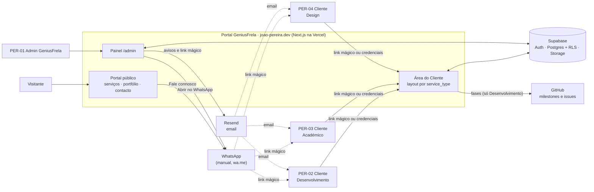

# Visão e âmbito — módulos Académico e Design
> Projeto: GeniusFrela — Área do Cliente multi-serviço · Tarefa: [M1-01] · Issue: #11 · Versão: 1.0 · Data: 2026-11-23
> Depende de: `docs/references/1/GeniusFrela_Projeto_e_Layouts.md`, `docs/especificacao_portal_cliente.md` (v1.2) · Perguntas/decisões usadas: Q-001…Q-007, D-001…D-011

## 1. Problema

A Área do Cliente foi feita para **um** serviço, o Desenvolvimento de Soluções Digitais. As fases são lidas dos milestones do GitHub (`lib/github/phases.ts`). A GeniusFrela presta mais dois serviços, **Académico** e **Design**. Estes projetos não têm repositório, duram dias ou semanas em vez de meses, e o que o cliente quer saber é diferente:

| Serviço | O que o cliente quer saber primeiro |
|---|---|
| Desenvolvimento | Em que fase está, que tarefas fechámos, onde testo a demo |
| Académico | **Quantos dias faltam**, quantos capítulos estão feitos, se o índice está aprovado |
| Design | **Qual é a última prova**, quantas rondas me restam, quando levanto a peça |

Hoje, os clientes destes dois serviços são acompanhados só por WhatsApp. As referências, as provas e as aprovações perdem-se nas conversas, e não há registo de "o cliente aprovou a arte".

## 2. Visão

> Qualquer cliente da GeniusFrela, seja qual for o serviço, entra com um link e vê numa só página **em que fase está**, **o que precisa de fazer** (aprovar, enviar, pagar) e **o que já recebeu**. Tudo isto com a cor e os blocos do seu serviço.

Um serviço novo deve ser **só configuração**: um `service_type`, as fases como dados (`phase_templates`) e os blocos que usa. Não deve ser preciso um layout novo de raiz.

## 3. Objetivos

| # | Objetivo | Como se mede |
|---|---|---|
| O1 | Acompanhar projetos Académico e Design pelo portal | 1 projeto piloto de cada serviço percorre as 7 fases (G3) |
| O2 | Registo formal de aceites e aprovações | Cada aceite de orçamento, índice e arte fica com data e autor |
| O3 | Reduzir perguntas de ponto de situação por WhatsApp | Prazo, fase atual e próximo passo visíveis sem abrir "ver detalhes" |
| O4 | Entrar sem palavra-passe | Link mágico de uso único gerado no admin em ≤ 2 cliques |
| O5 | Zero regressão no serviço Desenvolvimento | E2E do layout Tech igual antes e depois (M9-04) |

## 4. Diagrama de contexto

Fonte: `src/contexto-modulos.mmd` · Imagem: `img/contexto-modulos.png` (*por gerar*, ver §8)

| Sistema externo | Papel | Já existe? |
|---|---|---|
| Supabase | Auth (senha + link mágico), dados com RLS, Storage (capas; novo bucket privado de ficheiros) | Sim (plano gratuito) |
| GitHub | Fonte das fases **só** para projetos Desenvolvimento (D-001) | Sim |
| Resend | Emails de aviso e de link mágico | Sim (domínio verificado) |
| WhatsApp | Canal manual: o admin abre `wa.me` com a mensagem e o link já preenchidos (D-011) | Não há integração; é só um link |

## 5. Âmbito (v1.1)

### 5.1 Comum aos 3 serviços (M5)
- `service_type` no projeto (`development` | `academic` | `design`), escolhido no admin ao criar o projeto.
- **Fases como dados** para Académico e Design (`phase_templates` + `project_phases`), avançadas pelo admin. O Desenvolvimento continua a usar o GitHub (D-001).
- **Tema por serviço:** neutros comuns e acentos por módulo do **Design System V1** (Azul Sistema, Lilás Criativo, Âmbar Saber), aplicados por `data-service` (ADR-004; substitui a D-004).
- **Esqueleto comum:** etiqueta do serviço · prazo · estado · barra de fases · fase atual + próximo passo.
- **Ficheiros:** o admin envia entregáveis e provas. O **cliente envia referências** nas fases de briefing e revisão, com limite de tamanho e tipos (D-010).
- **Aprovações:** aprovar ou pedir alterações, com comentário e histórico. Só o admin reabre.
- **Pagamentos:** **só mostrar.** O admin regista o sinal, o restante e os extras, com o estado. O pagamento acontece fora do portal (D-009).
- **Link mágico:** uso único e validade curta, gerado no admin, com "Copiar", "Abrir no WhatsApp" e envio por email. As credenciais ficam como alternativa (D-011).

### 5.2 Académico (M6)
Fases: Pedido e briefing → Orçamento e aceite → Estrutura (índice) → Desenvolvimento → Revisão e formatação → Entrega final → Ajustes.
Blocos: **contagem do prazo** em destaque · progresso por **capítulos** · **ficha do trabalho** (instituição, nível, disciplina, normas, nº de páginas). Acento **Âmbar Saber** `#E8B65A` (Design System V1, ADR-004).

### 5.3 Design (M7)
Fases: Briefing → Orçamento e sinal → Conceito → Revisões → Aprovação final da arte → Produção/impressão → Entrega/levantamento.
Blocos: **galeria de provas** (V1, V2…) · **contador de rondas** incluídas · **ficha técnica** · **aviso**: depois de aprovar a arte, a produção não pode ser alterada. Acento **Lilás Criativo** `#A78BFA` (Design System V1, ADR-004).

### 5.4 Portal público (*should*)
Uma página por serviço e um filtro por serviço no Portfólio (M6-08, M7-08).

## 6. Fora de âmbito (v1.1)

| Item | Porquê | Decisão |
|---|---|---|
| Pagamento online (gateway, referência Multicaixa) | Custo e âmbito; o registo manual chega para a transparência | D-009 |
| Faturação / emissão de recibos | Continua fora, como na v1.2 | spec §1.2 |
| Envio automático por WhatsApp Business API | Exige um fornecedor, templates aprovados e custo por mensagem | D-011 |
| Chat em tempo real | As mensagens continuam assíncronas | spec §1.2 |
| Registo público de clientes | As contas continuam a ser criadas só pelo admin | spec §1.2 |
| Mudar o Tech para 7 fases | Fica com as 6 atuais; reavaliar no G1 | D-005 |
| Gestão de produção com gráficas externas | Só o estado da produção é mostrado ao cliente | Assumido |
| App mobile nativa | O portal é web responsivo (mobile-first) | Assumido |

## 7. Contradições encontradas e como ficam

| # | Documento de layouts diz | Código / spec atual | Fica |
|---|---|---|---|
| C1 | Desenvolvimento com 7 fases | 6 fases (`lib/portal/phases.ts`) | 6 fases (D-005, confirmar no G1) |
| C2 | Base `#0B0F1A` + roxo `#7C3AED` | Ameixa `#110d18` + lavanda `#b9a8f5` | A base atual; só os acentos por serviço (D-004) |
| C3 | Blocos Pagamentos, Aprovações e Ficheiros são comuns | Não existem; a spec v1.2 põe os pagamentos fora de âmbito | Entram na M5; pagamentos só mostrados (D-002, D-009) |
| C4 | Entrada por link mágico | Só email + senha temporária | Link mágico + senha como alternativa (D-011) |
| C5 | "Fases como dados (tabela `phases`)" | Fases vêm do GitHub | Dados para Académico e Design; GitHub para o Tech (D-001) |

## 8. Pendentes
- Gerar `img/contexto-modulos.png` a partir de `src/contexto-modulos.mmd`. Precisa do `mermaid-cli`, que não foi autorizado nesta sessão. O GitHub já renderiza o bloco Mermaid acima.
- As personas vêm na M1-02 (#12).
