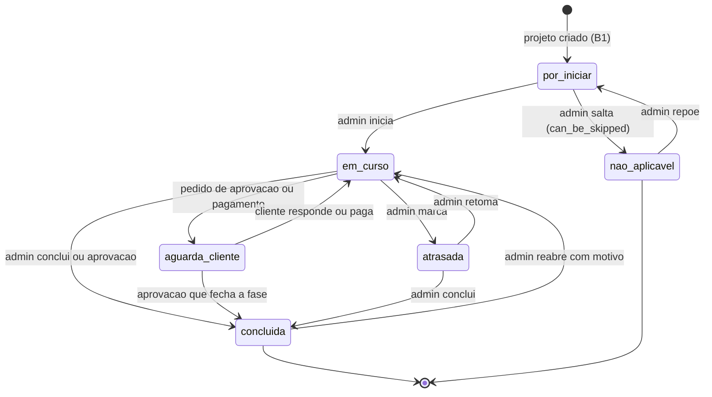
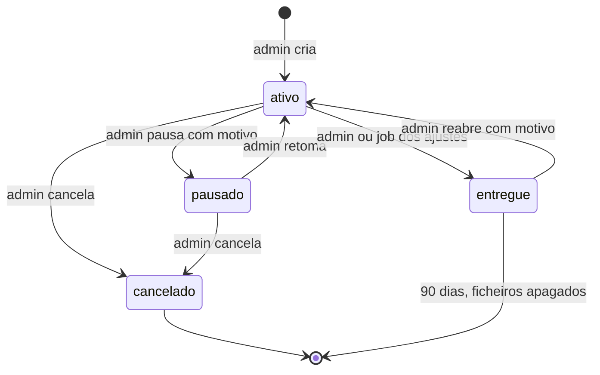
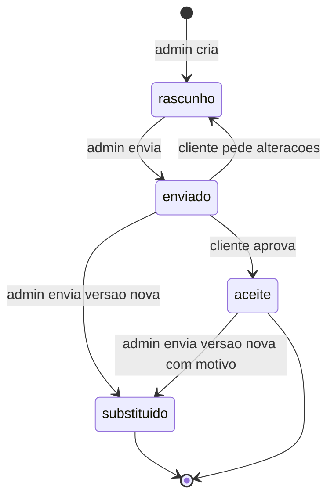
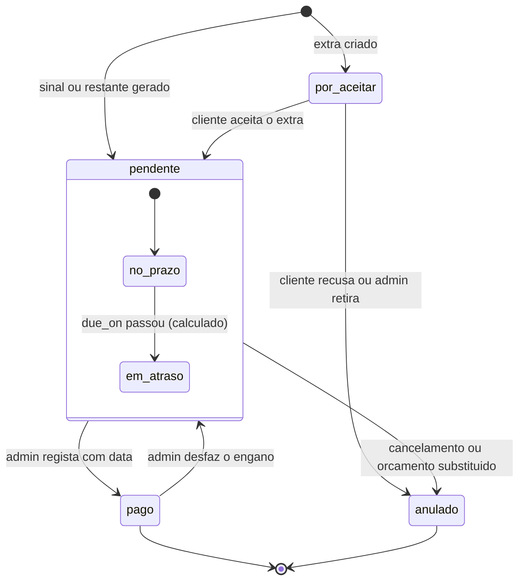
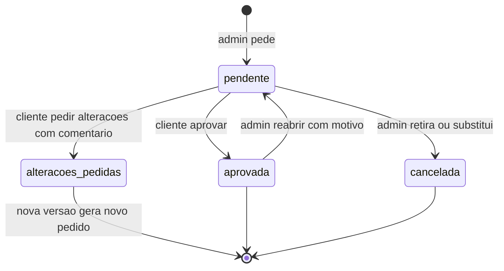
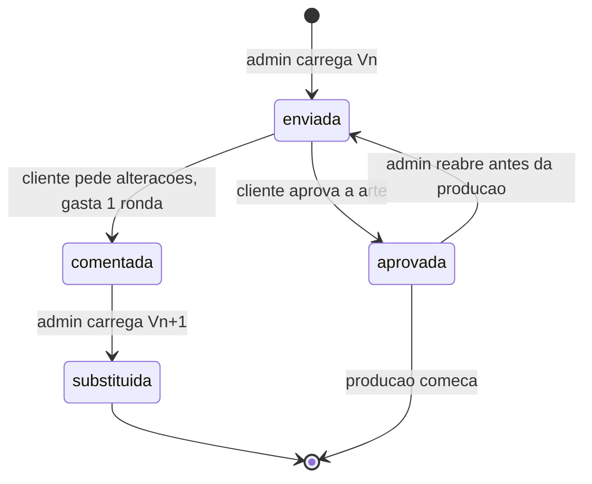
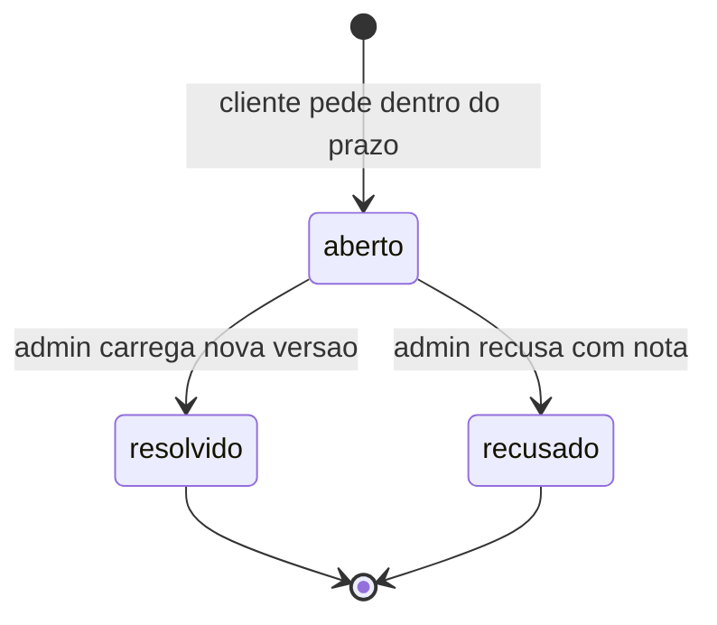

# Diagramas de estados
> Projeto: GeniusFrela — Área do Cliente multi-serviço · Tarefa: [M2-05] · Issue: #24 · Versão: 1.0 · Data: 2026-11-24
> Depende de: `mer/*.md`, `dicionario-dados.md`, `regras-negocio.md` · Perguntas/decisões usadas: Q-055…Q-058, D-046, D-049, D-052, D-053, D-059, D-060, D-062…D-066

Cada diagrama tem a fonte em `../src/estados-<nome>.mmd`. As imagens em `../img/` ficam por gerar, porque falta autorizar o `mermaid-cli`. Cada tabela diz **quem** faz cada transição, em que **condição** e com que **efeitos**. Uma transição que não está na tabela é recusada pela base de dados (trigger), na M5.

| # | Diagrama |
|---|---|
| 1 | [Fase do projeto (`project_phases.status`)](#1-fase) |
| 2 | [Projeto (`projects.status`)](#2-projeto) |
| 3 | [Orçamento (`quotes.status`)](#3-orcamento) |
| 4 | [Pagamento (`payments.status`)](#4-pagamento) |
| 5 | [Aprovação (`approvals.status`)](#5-aprovacao) |
| 6 | [Prova de design (vista composta: `deliverables` `prova` + `approvals` `prova`)](#6-prova) |
| 7 | [Pedido de ajuste (`adjustment_requests.status`)](#7-ajuste) |

## 1. Fase do projeto (`project_phases.status`)

| De | Para | Quem | Condição | Efeitos |
|---|---|---|---|---|
| — | por_iniciar | sistema | projeto Académico/Design criado | evento de criação |
| por_iniciar | em_curso | admin | nenhum pagamento `gates_phase_id` por pagar (D-052) | `started_at` na 1.ª vez |
| por_iniciar | nao_aplicavel | admin / sistema | `can_be_skipped`; o sistema faz com `has_print = false` (F2) ou `uses_chapters = false` | — |
| em_curso | aguarda_cliente | admin / sistema | aprovação ou pagamento pedido ao cliente | **abre a espera**: o prazo desliza (RN-21) |
| aguarda_cliente | em_curso | cliente / sistema | resposta `pedir_alteracoes`, pagamento registado ou admin retoma | fecha a espera |
| em_curso | atrasada | admin | — | contagem a vermelho (RN-24); não desliza o prazo |
| atrasada | em_curso | admin | — | — |
| em_curso / aguarda_cliente / atrasada | concluida | admin / sistema | resposta `aprovar` que fecha a fase, ou admin | `completed_at` |
| concluida | em_curso | **só admin** | **motivo obrigatório** (D-062) | limpa `completed_at`; as outras fases não mudam |
| nao_aplicavel | por_iniciar | admin | ex.: a peça passou a ter impressão (F2) | — |

- **Sequência flexível (D-063):** várias fases podem estar em curso ao mesmo tempo. A fase **atual** mostrada em destaque é a primeira, por `position`, que não está `concluida` nem `nao_aplicavel`; as outras em curso aparecem assim na barra de fases.
- **Atrasada automática** (D-046): `por_iniciar`/`em_curso` com `due_on` passado é *mostrada* como atrasada, sem transição gravada.
- Toda a transição grava um `phase_events` (B5).

## 2. Projeto (`projects.status`)

| De | Para | Quem | Condição | Efeitos |
|---|---|---|---|---|
| — | ativo | admin | — | fases criadas (B1) |
| ativo | pausado | admin | motivo obrigatório; indica se é **a pedido do cliente** | se for a pedido do cliente, **o prazo desliza** enquanto estiver pausado (D-064) |
| pausado | ativo | admin | — | fecha o intervalo de pausa |
| ativo | entregue | admin / job | Design: `delivered_at`; Académico: fim dos ajustes sem pedidos abertos (D-059) | `completed_at`: começam os 90 dias (RN-08) |
| entregue | ativo | **só admin** | **motivo obrigatório** (D-065) | limpa `completed_at`: **para** a contagem dos 90 dias |
| ativo / pausado | cancelado | admin | — | `cancelled_at`; pagamentos pendentes → `anulado`; o sinal pago fica (RN-13) |

- `cancelado` é final.
- As transições ficam em `project_status_events` (nova, D-066), que o cliente pode ler: o prazo ajustado precisa dos intervalos de pausa a pedido do cliente.
- **Prazo ajustado** = `due_on` + dias em `aguarda_cliente` (fases) + dias em `pausado` a pedido do cliente (projeto). Os intervalos sobrepostos contam uma só vez.

## 3. Orçamento (`quotes.status`)

| De | Para | Quem | Condição | Efeitos |
|---|---|---|---|---|
| — | rascunho | admin | — | — |
| rascunho | enviado | admin | nenhum outro `enviado`/`aceite` | cria a aprovação `orcamento` com `snapshot`; fase 2 → `aguarda_cliente` |
| enviado | aceite | cliente | resposta `aprovar` | gera sinal e restante; `due_on` copiado; fase 2 → `concluida` |
| enviado | rascunho | cliente | resposta `pedir_alteracoes` | o admin corrige e volta a enviar |
| enviado | substituido | admin | envia uma versão nova | a aprovação pendente passa a `cancelada` |
| aceite | substituido | admin | **motivo obrigatório** (ex.: mudança de âmbito, RN-32) | pagamentos pendentes do antigo → `anulado`; os pagos ficam |

## 4. Pagamento (`payments.status`)

| De | Para | Quem | Condição | Efeitos |
|---|---|---|---|---|
| — | pendente | sistema | orçamento aceite | — |
| — | por_aceitar | admin | extra (ex.: ronda adicional) | cria a aprovação `extra` |
| por_aceitar | pendente | cliente | resposta `aprovar` | passa a contar nos totais (RN-07) |
| por_aceitar | anulado | cliente / admin | `pedir_alteracoes` ou o admin retira | — |
| pendente | pago | admin | `paid_on` obrigatório | destrava a fase `gates_phase_id` e as versões bloqueadas |
| pago | pendente | admin | correção de engano (RF-30.22) | volta a travar; fica no `activity_log` |
| pendente | anulado | sistema / admin | projeto cancelado ou orçamento substituído | sai dos totais |

- **Em atraso** é um subestado *calculado* de `pendente` (D-053): `due_on` passou e ainda não está pago. Não há transição gravada.

## 5. Aprovação (`approvals.status`)

| De | Para | Quem | Condição | Efeitos |
|---|---|---|---|---|
| — | pendente | admin / sistema | 1 só pendente por alvo | `snapshot` gravado; fase → `aguarda_cliente` |
| pendente | aprovada | cliente | — | efeitos por `subject` (`blocos-comuns.md` §3.4); `decided_at` |
| pendente | alteracoes_pedidas | cliente | comentário obrigatório (RN-06) | `prova`: **gasta 1 ronda**; fase → `em_curso` |
| pendente | cancelada | admin | ex.: orçamento substituído | — |
| aprovada | pendente | **só admin** | motivo; `prova`: só se `producao` ainda não começou (RN-43) | nova resposta `reabrir` |

- `aprovada` é definitiva para o cliente (RN-05). `alteracoes_pedidas` é final para aquele pedido: a versão seguinte tem um pedido novo (D-049).

## 6. Prova de design (vista composta: `deliverables` `prova` + `approvals` `prova`)

| De | Para | Quem | Condição | Efeitos |
|---|---|---|---|---|
| — | enviada | admin | fase `conceito` (V1) ou `revisoes` (V2+); V2+ exige rondas restantes ou extra aceite (RN-36) | aprovação `prova` pendente; email ao cliente (Should) |
| enviada | comentada | cliente | comentário obrigatório; imagem opcional | rondas usadas + 1 |
| enviada | aprovada | cliente | aviso de irreversibilidade com os textos-chave (RN-42) | `snapshot` com a versão e os textos-chave; fase `aprovacao-arte` → `concluida` |
| comentada | substituida | admin | — | a nova versão passa a ser a atual |
| aprovada | enviada | **só admin** | `producao` ainda `por_iniciar` (RN-43) | resposta `reabrir` |

- Não há coluna de estado na prova: o estado vem da aprovação ligada (D-060). **Ronda X de N** = respostas `pedir_alteracoes` / `quotes.rounds_included`.

## 7. Pedido de ajuste (`adjustment_requests.status`)

| De | Para | Quem | Condição | Efeitos |
|---|---|---|---|---|
| — | aberto | cliente | `now() <= delivered_at + adjust_days` (F3) | — |
| aberto | resolvido | admin | `resolved_by_deliverable_id` obrigatório | nova versão PDF + Word |
| aberto | recusado | admin | `admin_note` obrigatória (ex.: trabalho novo, RN-32) | pode gerar um `extra` |

- Enquanto houver um pedido `aberto`, o job dos ajustes não conclui o projeto (RN-34).
