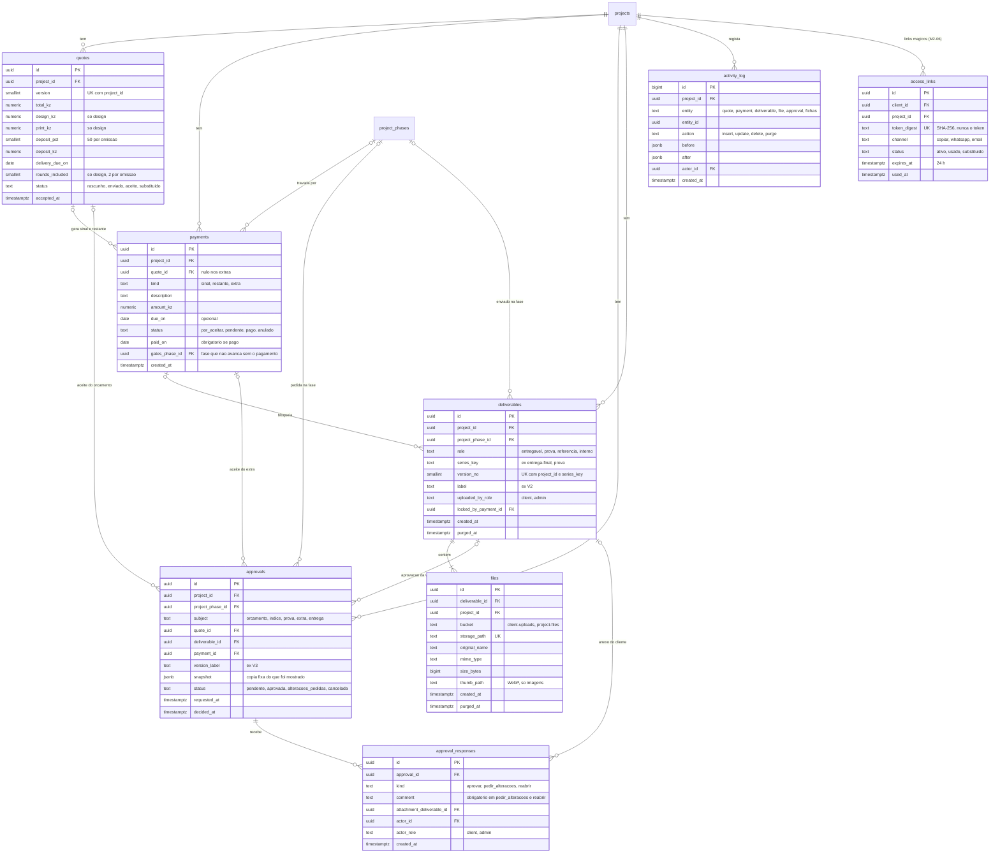

# MER — Pagamentos, Aprovações e Ficheiros
> Projeto: GeniusFrela — Área do Cliente multi-serviço · Tarefa: [M2-02] · Issue: #21 · Versão: 1.3 (M3-03: dois buckets) · Data: 2026-11-24
> Depende de: `mer/fases-servicos.md` (M2-01), `requisitos-funcionais.md` (RF-30.2, RF-30.3, RF-30.4), `regras-negocio.md`, `requisitos-nao-funcionais.md` (RNF-3) · Perguntas/decisões usadas: Q-046…Q-049, D-009, D-013, D-017, D-018, D-022, D-024, D-025, D-026, D-033, D-037, D-048…D-054

## 1. O que este modelo resolve
São os três blocos comuns aos 3 serviços (D-002), mais o orçamento, que é a origem dos pagamentos:

| Bloco | Tabelas | Para quê |
|---|---|---|
| Orçamento | `quotes` | O que foi proposto (total, design + impressão, sinal, prazo, rondas). Quando é aceite, gera o sinal e o restante |
| Pagamentos | `payments` | Sinal, restante e extras, só registados pelo admin (D-009). Podem travar uma fase |
| Aprovações | `approvals`, `approval_responses` | Um pedido por **versão** concreta, com cópia fixa do que foi mostrado, e as respostas do cliente e as reaberturas do admin |
| Ficheiros | `deliverables`, `files` | Uma **versão** (V1, V2…) com um ou mais ficheiros; pode ficar bloqueada até um pagamento |
| Auditoria | `activity_log` | Rasto de tudo o que muda em orçamentos, pagamentos e ficheiros (RNF-308) |

## 2. Diagrama
Fonte: [`../src/mer-blocos-comuns.mmd`](../src/mer-blocos-comuns.mmd) · Imagem: `../img/mer-blocos-comuns.png` *(por gerar: falta autorizar o `mermaid-cli`)*

## 3. Entidades

### 3.1 `quotes` — orçamento (D-050)
| Coluna | Tipo | Nulo | Default | Regra |
|---|---|---|---|---|
| `id` | uuid | não | `gen_random_uuid()` | PK |
| `project_id` | uuid | não | — | FK → `projects` on delete cascade |
| `version` | smallint | não | — | 1, 2… **UK (`project_id`, `version`)**. Um orçamento novo substitui o anterior sem o apagar |
| `total_kz` | numeric(12,2) | não | — | `> 0` |
| `design_kz`, `print_kz` | numeric(12,2) | sim | — | só no Design (RF-20.20); se os dois existirem, `design_kz + print_kz = total_kz` |
| `deposit_pct` | smallint | não | `50` | `between 1 and 100` (RN-12) |
| `deposit_kz` | numeric(12,2) | não | — | por omissão `total × pct`, arredondado; o admin pode acertar o valor |
| `delivery_due_on` | date | sim | — | ao aceitar, é copiado para `projects.due_on` |
| `rounds_included` | smallint | sim | — | só no Design, por omissão `2` (D-017); `check (>= 0)` |
| `status` | text | não | `'rascunho'` | `rascunho` → `enviado` → `aceite`; um orçamento mais recente passa o anterior a `substituido` |
| `sent_at`, `accepted_at` | timestamptz | sim | — | |
| `created_by`, `created_at` | — | — | — | |

Só pode haver **um** orçamento `enviado` ou `aceite` por projeto (índice único parcial).

### 3.2 `payments` — pagamentos (D-026)
| Coluna | Tipo | Nulo | Default | Regra |
|---|---|---|---|---|
| `id` | uuid | não | `gen_random_uuid()` | PK |
| `project_id` | uuid | não | — | FK → `projects` on delete cascade |
| `quote_id` | uuid | sim | — | FK → `quotes`; preenchido no sinal e no restante gerados pelo orçamento |
| `kind` | text | não | — | `sinal`, `restante`, `extra` |
| `description` | text | não | — | ex.: "Ronda extra de revisão" |
| `amount_kz` | numeric(12,2) | não | — | `> 0` |
| `due_on` | date | sim | — | data limite opcional |
| `status` | text | não | `'pendente'` | `por_aceitar` (extra à espera do aceite, RN-07) · `pendente` · `pago` · `anulado` |
| `paid_on` | date | sim | — | `check ((status = 'pago') = (paid_on is not null))` |
| `gates_phase_id` | uuid | sim | — | FK → `project_phases`: a fase que **não pode passar a em curso** enquanto este pagamento não estiver pago (RN-11, RN-15) |
| `created_by`, `created_at`, `updated_at` | — | — | — | |

- **Em atraso** não é gravado: é `pendente` com `due_on` ultrapassado (fuso Africa/Luanda), calculado na leitura, como na D-046 (D-053).
- **Totais para o cliente** (RF-30.23): contam `pendente` e `pago`. `por_aceitar` e `anulado` não contam.
- Desfazer um "pago" (RF-30.22) é um `update` normal, e o `activity_log` guarda o antes e o depois.

### 3.3 `approvals` — pedidos de aprovação (D-049)
| Coluna | Tipo | Nulo | Default | Regra |
|---|---|---|---|---|
| `id` | uuid | não | `gen_random_uuid()` | PK |
| `project_id` | uuid | não | — | FK → `projects` on delete cascade |
| `project_phase_id` | uuid | sim | — | FK → `project_phases`: a fase onde a aprovação foi pedida. Nulo no Desenvolvimento |
| `subject` | text | não | — | `orcamento`, `indice`, `prova`, `extra`, `entrega` |
| `quote_id` / `deliverable_id` / `payment_id` | uuid | sim | — | o alvo: `orcamento` → `quote_id`; `prova`, `entrega` → `deliverable_id`; `extra` → `payment_id`; `indice` → nenhum (o índice vai no `snapshot`) |
| `version_label` | text | sim | — | ex.: `V3` |
| `snapshot` | jsonb | não | — | **cópia fixa** do que o cliente viu (valores do orçamento, textos-chave da ficha, lista do índice, nomes dos ficheiros). Não se altera depois de criada |
| `status` | text | não | `'pendente'` | `pendente` · `aprovada` · `alteracoes_pedidas` · `cancelada` (o admin retira o pedido) |
| `requested_by`, `requested_at` | — | — | — | |
| `decided_at` | timestamptz | sim | — | |

- Uma `check` garante que o alvo condiz com o `subject`.
- Só pode haver **um** pedido `pendente` por alvo.
- "Pedir alterações" **fecha** o pedido. A versão seguinte (ex.: V4) é um pedido novo, e assim cada versão tem o seu registo.

### 3.4 `approval_responses` — respostas e reaberturas
| Coluna | Tipo | Nulo | Default | Regra |
|---|---|---|---|---|
| `id` | uuid | não | `gen_random_uuid()` | PK |
| `approval_id` | uuid | não | — | FK → `approvals` on delete cascade |
| `kind` | text | não | — | `aprovar` · `pedir_alteracoes` · `reabrir` |
| `comment` | text | sim | — | **obrigatório** em `pedir_alteracoes` (RN-06) e em `reabrir` (RN-05); até 2000 caracteres |
| `attachment_deliverable_id` | uuid | sim | — | imagem opcional do cliente no pedido de alterações (RF-20.40) |
| `actor_id` | uuid | não | `auth.uid()` | FK → `auth.users` |
| `actor_role` | text | não | — | `client`, `admin` |
| `created_at` | timestamptz | não | `now()` | |

**Só inserção.** Um trigger atualiza `approvals.status`:

| Resposta | Quem | De → para | Efeitos |
|---|---|---|---|
| `aprovar` | cliente | `pendente` → `aprovada` | orçamento → `aceite` e geração do sinal e do restante; extra → `pendente`; fase → `concluida` se o pedido a fechava |
| `pedir_alteracoes` | cliente | `pendente` → `alteracoes_pedidas` | numa `prova`, **gasta uma ronda** (RN-35); a fase volta a `em_curso` |
| `reabrir` | **só admin** | `aprovada` → `pendente` | bloqueado numa `prova` se a fase `producao` já tiver começado (RN-43, D-037) |

**Rondas usadas** (RF-20.41) = nº de respostas `pedir_alteracoes` em pedidos `prova` do projeto. **Rondas restantes** = `quotes.rounds_included` (do orçamento aceite) − usadas. Não se grava um contador.

### 3.5 `deliverables` — versões (D-048)
| Coluna | Tipo | Nulo | Default | Regra |
|---|---|---|---|---|
| `id` | uuid | não | `gen_random_uuid()` | PK |
| `project_id` | uuid | não | — | FK → `projects` on delete cascade |
| `project_phase_id` | uuid | sim | — | FK → `project_phases`; nulo no Desenvolvimento |
| `role` | text | não | — | `entregavel` · `prova` · `referencia` · `interno` (o cliente não vê) |
| `series_key` | text | não | — | agrupa as versões do mesmo objeto: `prova`, `entrega-final`, `referencias`, `ficheiros-finais`… |
| `version_no` | smallint | não | — | 1, 2… **UK (`project_id`, `series_key`, `version_no`)**; uma versão nova nunca apaga a anterior (RF-30.43) |
| `label` | text | não | — | `V1`, `V2`… |
| `title`, `notes` | text | sim | — | |
| `uploaded_by_role` | text | não | — | `client` só com `role = 'referencia'` e numa fase com `client_can_upload` (RN-09) |
| `locked_by_payment_id` | uuid | sim | — | FK → `payments`: enquanto o pagamento não estiver `pago`, o cliente vê a versão mas **não descarrega** (RF-30.44, RNF-304) |
| `created_by`, `created_at` | — | — | — | |
| `purged_at` | timestamptz | sim | — | preenchido quando os ficheiros são apagados aos 90 dias (RN-08); o registo fica |

**Versão atual** de uma série = a de `version_no` mais alto.

### 3.6 `files` — ficheiros de uma versão
| Coluna | Tipo | Nulo | Default | Regra |
|---|---|---|---|---|
| `id` | uuid | não | `gen_random_uuid()` | PK |
| `deliverable_id` | uuid | não | — | FK → `deliverables` on delete cascade |
| `project_id` | uuid | não | — | repetido para a RLS e para as políticas do Storage |
| `bucket` | text | não | — | `client-uploads` (cliente, 10 MB) ou `project-files` (admin, 50 MB), ADR-003 |
| `storage_path` | text | não | — | **UK (`bucket`, `storage_path`)**; `{project_id}/{deliverable_id}/{file_id}.{ext}` |
| `original_name` | text | não | — | nome mostrado ao descarregar |
| `mime_type` | text | não | — | cliente: JPG, PNG, WebP, HEIC, PDF, DOC, DOCX (D-024); admin: também AI/PSD/ZIP para ficheiros finais |
| `size_bytes` | bigint | não | — | cliente `≤ 10 MB`; admin `≤ 50 MB` (máximo do plano gratuito, RNF-503) |
| `thumb_path` | text | sim | — | miniatura WebP (≤ 150 KB) das imagens (RNF-103) |
| `width`, `height` | integer | sim | — | |
| `created_at` | timestamptz | não | `now()` | |
| `purged_at` | timestamptz | sim | — | |

Limite do cliente: **10 ficheiros por fase** (RN-09), verificado por trigger contando os `files` de `deliverables` com `uploaded_by_role = 'client'` nessa fase.

### 3.7 `activity_log` — auditoria (D-051)
| Coluna | Tipo | Nulo | Default | Regra |
|---|---|---|---|---|
| `id` | bigint identity | não | — | PK |
| `project_id` | uuid | sim | — | FK → `projects` on delete set null (o rasto sobrevive ao projeto) |
| `entity` | text | não | — | `quote`, `payment`, `deliverable`, `file`, `approval`, `academic_brief`, `design_spec` (as fichas da M2-03, regra F6) |
| `entity_id` | uuid | não | — | |
| `action` | text | não | — | `insert`, `update`, `delete`, `purge` |
| `before`, `after` | jsonb | sim | — | a linha antes e depois |
| `actor_id` | uuid | sim | `auth.uid()` | nulo quando é o sistema (ex.: a limpeza dos 90 dias) |
| `created_at` | timestamptz | não | `now()` | |

É preenchida por um trigger genérico nas tabelas acima. É **só de inserção** e só o admin a lê. `phase_events` e `approval_responses` continuam à parte, porque o cliente os vê.

## 4. Como os blocos se ligam ao fluxo
| Momento | O que acontece nos dados | RF / RN |
|---|---|---|
| Admin envia o orçamento | `quotes.status = enviado` + `approvals` (`subject = orcamento`, `snapshot` com valores e a regra do sinal não reembolsável) + fase 2 → `aguarda_cliente` | RF-10.21, RF-20.21, RF-30.06 |
| Cliente aceita | resposta `aprovar` → `quotes.status = aceite`, `projects.due_on` atualizado, criados `payments` **sinal** (`gates_phase_id` = fase 3) e **restante** | RN-11, RN-12 |
| Restante — Académico | `deliverables` da entrega final com `locked_by_payment_id` = restante | RN-14 |
| Restante — Design | `payments.gates_phase_id` = fase `producao` | RN-15 |
| Ronda extra (Design) | `payments` `extra` com `status = por_aceitar` + `approvals` `subject = extra`; ao aceitar → `pendente` | RN-07, RN-36 |
| Prova Vn | `deliverables` (`role = prova`, `series_key = prova`, `version_no = n`) + `approvals` `subject = prova` | RF-20.30, RF-20.42 |
| Aprovação da arte | resposta `aprovar` numa `prova`; `snapshot` com os textos-chave da ficha | RN-41, RN-42 |
| Projeto cancelado | `payments` pendentes → `anulado`; o sinal pago fica | RN-13 |
| 90 dias após a conclusão | job: apaga os objetos do Storage, preenche `purged_at` e regista `purge` no `activity_log` | RN-08 |

Um trigger em `project_phases` recusa passar uma fase a `em_curso` com um pagamento `gates_phase_id` ainda por pagar (D-052).

## 5. Cardinalidades
| Relação | Cardinalidade |
|---|---|
| `projects` → `quotes` | 1 : 0..N (no máximo 1 enviado/aceite) |
| `quotes` → `payments` | 0..1 : 0..2 (sinal e restante) |
| `projects` → `payments` | 1 : 0..N |
| `project_phases` → `payments` (trava) | 0..1 : 0..N |
| `projects` → `approvals` | 1 : 0..N |
| `approvals` → `approval_responses` | 1 : 0..N |
| `deliverables` → `files` | 1 : 1..N |
| `payments` → `deliverables` (bloqueio) | 0..1 : 0..N |

## 6. Segurança (provisória; a matriz final é a M3-06)
| Tabela | Cliente (do seu projeto) | Admin |
|---|---|---|
| `quotes` | lê os `enviado`, `aceite` e `substituido` | tudo |
| `payments` | lê, exceto os `anulado` | tudo |
| `approvals` | lê | tudo |
| `approval_responses` | lê; **insere** `aprovar` e `pedir_alteracoes` num pedido `pendente` | lê e insere (incluindo `reabrir`) |
| `deliverables` | lê, exceto `interno`; **insere** `referencia` nas fases com `client_can_upload` | tudo |
| `files` | lê os metadados; obtém **URL assinada ≤ 1 h** só se a versão não estiver bloqueada nem apagada | tudo |
| `activity_log` | — | lê |
| Storage `project-files` | sem acesso direto: tudo por URL assinada gerada no servidor | tudo, pelo servidor |

## 7. Fora deste modelo
- **Link mágico** (RF-30.57): tabela `access_links`, descrita em `sequencia/sequencias.md` §1 (M2-06) e mostrada no diagrama acima.
- **Mensagens**: continua a tabela `feedback`. Em Académico e Design, uma mensagem `fase` guarda em `target_ref` a `position` da fase.
- **Fichas, capítulos e o prazo de ajustes**: M2-03 (#22).

## 8. Impacto no código (para a M5)
- Migração `0006_pagamentos_aprovacoes_ficheiros.sql` (M5-03, #41): as 8 tabelas, o bucket privado `project-files`, os triggers (respostas, auditoria, travão de fase, limite de 10 ficheiros) e a RLS.
- O envio e o download de ficheiros passam sempre por Server Actions, que validam o tipo pela assinatura do ficheiro e o tamanho (RNF-305) e geram as URLs assinadas (RNF-303).
