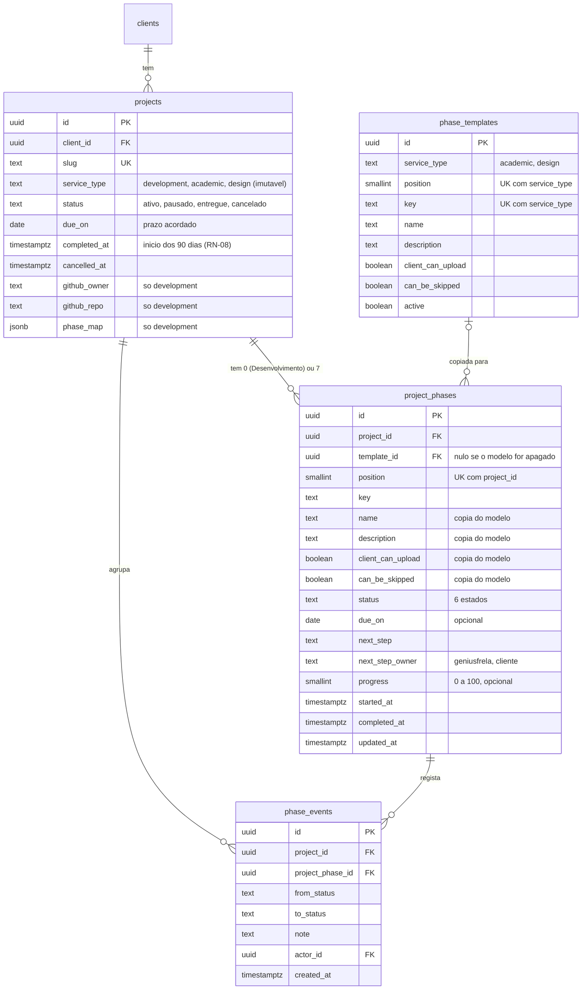

# MER — Tipo de serviço e fases como dados
> Projeto: GeniusFrela — Área do Cliente multi-serviço · Tarefa: [M2-01] · Issue: #20 · Versão: 1.0 · Data: 2026-11-23
> Depende de: `supabase/migrations/0001…0004`, `lib/portal/phases.ts`, `docs/01-requisitos/requisitos-funcionais.md` (RF-30.0x, RF-10.0x, RF-20.0x), `regras-negocio.md` · Perguntas/decisões usadas: Q-001, Q-042…Q-045, D-001, D-005, D-014, D-020, D-034, D-042…D-047

## 1. O que este modelo resolve
Hoje as fases vêm **só** dos milestones do GitHub (`lib/github/phases.ts`), agrupadas nas 6 fases de `lib/portal/phases.ts`. Os projetos Académico e Design não têm repositório, por isso as suas fases passam a ser **dados no Supabase** (D-001):

- `projects.service_type` diz de que serviço é o projeto.
- `phase_templates` guarda o **modelo** de 7 fases de cada serviço.
- `project_phases` guarda as **fases de cada projeto**, copiadas do modelo, com o estado atual.
- `phase_events` guarda o **histórico** de cada mudança de estado.

Os projetos **Desenvolvimento não mudam**. Não têm linhas em `project_phases` e continuam a ler as fases do GitHub (D-001, D-005, RNF-701).

## 2. Diagrama
Fonte: [`../src/mer-fases.mmd`](../src/mer-fases.mmd) · Imagem: `../img/mer-fases.png` *(por gerar: o `mermaid-cli` não foi autorizado nesta sessão; o GitHub mostra o diagrama abaixo)*

## 3. Entidades e chaves

### 3.1 `projects` (alterada)
| Coluna | Tipo | Nulo | Default | Regra | Origem |
|---|---|---|---|---|---|
| `service_type` | text | não | `'development'` | `check in ('development','academic','design')`; **não pode mudar** depois de criado (trigger) | RF-30.01, RN-02 |
| `status` | text | não | `'ativo'` | passa a aceitar também `'cancelado'` → `('ativo','pausado','entregue','cancelado')` | RF-30.06, RN-13 |
| `completed_at` | timestamptz | sim | — | preenchido quando `status` passa a `'entregue'`; conta os 90 dias dos ficheiros | RN-08, RN-34 |
| `cancelled_at` | timestamptz | sim | — | preenchido quando `status` passa a `'cancelado'` | RF-30.06 |
| `github_owner`, `github_repo`, `phase_map` | — | sim | — | só podem ter valor se `service_type = 'development'` (`check`) | RF-30.02 |

Os projetos que já existem ficam com `service_type = 'development'` pelo default, e nada muda para eles.

### 3.2 `phase_templates` (nova)
| Coluna | Tipo | Nulo | Default | Regra |
|---|---|---|---|---|
| `id` | uuid | não | `gen_random_uuid()` | PK |
| `service_type` | text | não | — | `check in ('academic','design')`. O Desenvolvimento não tem modelo, porque usa o GitHub |
| `position` | smallint | não | — | `check between 1 and 20`; **UK (`service_type`, `position`)** |
| `key` | text | não | — | identificador estável (ex.: `revisoes`); **UK (`service_type`, `key`)**. O código usa a `key`, nunca o nome |
| `name` | text | não | — | nome mostrado ao cliente |
| `description` | text | não | `''` | frase curta da fase |
| `client_can_upload` | boolean | não | `false` | o cliente pode enviar referências nesta fase (RF-30.41) |
| `can_be_skipped` | boolean | não | `false` | a fase pode ficar "não aplicável" (RF-10.33, RF-20.62) |
| `active` | boolean | não | `true` | um modelo inativo não é copiado para projetos novos |

### 3.3 `project_phases` (nova)
| Coluna | Tipo | Nulo | Default | Regra |
|---|---|---|---|---|
| `id` | uuid | não | `gen_random_uuid()` | PK |
| `project_id` | uuid | não | — | FK → `projects.id` **on delete cascade** |
| `template_id` | uuid | sim | — | FK → `phase_templates.id` **on delete set null**. É a ligação ao modelo, mas a fase do projeto vale sozinha |
| `position`, `key`, `name`, `description`, `client_can_upload`, `can_be_skipped` | — | não | — | **copiados do modelo** ao criar o projeto (D-042); **UK (`project_id`, `position`)** e **UK (`project_id`, `key`)** |
| `status` | text | não | `'por_iniciar'` | ver §4 |
| `due_on` | date | sim | — | data-limite opcional da fase (D-044) |
| `next_step` | text | sim | — | próximo passo visível ao cliente (RF-30.04) |
| `next_step_owner` | text | sim | — | `check in ('geniusfrela','cliente')`: de quem está a ação (RF-10.04) |
| `progress` | smallint | sim | — | `check between 0 and 100`; % definida pelo admin quando não há capítulos (RF-10.43). Os capítulos são modelados na M2-03 |
| `started_at`, `completed_at` | timestamptz | sim | — | preenchidos pelo trigger de eventos (§5) |
| `updated_at` | timestamptz | não | `now()` | |

### 3.4 `phase_events` (nova)
| Coluna | Tipo | Nulo | Default | Regra |
|---|---|---|---|---|
| `id` | uuid | não | `gen_random_uuid()` | PK |
| `project_id` | uuid | não | — | FK → `projects.id` on delete cascade. Repetido de propósito, para a RLS e para as consultas por projeto |
| `project_phase_id` | uuid | não | — | FK → `project_phases.id` on delete cascade |
| `from_status` | text | sim | — | nulo no evento de criação |
| `to_status` | text | não | — | |
| `note` | text | sim | — | motivo (ex.: "à espera da aprovação do índice") |
| `actor_id` | uuid | sim | `auth.uid()` | FK → `auth.users.id` on delete set null; nulo quando é o sistema |
| `created_at` | timestamptz | não | `now()` | |

Os eventos são **só de inserção**: ninguém, nem o admin, os altera ou apaga pela API (RNF-308).

## 4. Estados de uma fase
| Estado (`status`) | Mostrado ao cliente | Quem o põe | Conta para o prazo? |
|---|---|---|---|
| `por_iniciar` | Por iniciar | criação do projeto | — |
| `em_curso` | Em curso | admin | sim |
| `aguarda_cliente` | A aguardar por si | admin (ou o sistema, quando pede uma aprovação ou um pagamento — M2-02) | **não**: o prazo desliza (RN-21) |
| `concluida` | Concluída | admin (ou o sistema, ao aprovar ou ao pagar — M2-02) | — |
| `atrasada` | Atrasada | admin | sim |
| `nao_aplicavel` | Não se aplica | admin, só se `can_be_skipped` | — |

- **Atrasada automática (D-046):** uma fase `por_iniciar` ou `em_curso` com `due_on` ultrapassado (fuso Africa/Luanda) é **mostrada** como atrasada sem mudar a linha. O admin pode também pôr `atrasada` à mão.
- **Fase atual:** a primeira, por `position`, cujo estado não é `concluida` nem `nao_aplicavel`. É a mesma regra do Desenvolvimento ("a primeira por concluir").
- As transições permitidas e os diagramas de estados ficam na M2-05 (#24).

## 5. Regras na base de dados
| # | Regra | Como | RF / RN |
|---|---|---|---|
| B1 | Ao inserir um projeto `academic` ou `design`, as fases do modelo ativo são **copiadas** para `project_phases`, na mesma transação | trigger `after insert on projects` (D-045) | RF-30.03, RF-10.01, RF-20.01 |
| B2 | Um projeto `development` **não pode** ter linhas em `project_phases` | trigger `before insert on project_phases` | D-001 |
| B3 | `service_type` não muda depois de criado | trigger `before update on projects` | RN-02 |
| B4 | `nao_aplicavel` só se `can_be_skipped = true` | `check (status <> 'nao_aplicavel' or can_be_skipped)` | RF-10.33, RF-20.62 |
| B5 | Cada mudança de `status` cria um `phase_events` e preenche `started_at` (1.ª vez em curso) e `completed_at` | trigger `after update of status on project_phases` | RNF-308 |
| B6 | Projeto `entregue` preenche `completed_at`; `cancelado` preenche `cancelled_at` | trigger `before update of status on projects` | RN-08, RF-30.06 |

## 6. Prazo ajustado (RN-21…RN-23)
- `projects.due_on` guarda **sempre o prazo acordado**. Não é reescrito.
- **Dias de espera** = soma dos intervalos em que uma fase do projeto esteve em `aguarda_cliente`, calculada a partir de `phase_events` (um intervalo ainda aberto conta até agora).
- **Prazo ajustado** = `due_on` + dias de espera, arredondados para cima. É calculado por uma função SQL `project_adjusted_due(project_id)` ou por uma view. Fica disponível para o cliente e para o admin (RF-30.07).
- O motivo mostrado ("à espera da sua aprovação desde DD/MM") vem do `note` e da data do evento que abriu a espera.

## 7. Conteúdo dos modelos (seed)
| Serviço | # | `key` | Nome | Cliente envia ficheiros | Pode saltar |
|---|---|---|---|---|---|
| academic | 1 | `pedido-briefing` | Pedido e briefing | sim | não |
| academic | 2 | `orcamento-aceite` | Orçamento e aceite | não | não |
| academic | 3 | `estrutura` | Estrutura (índice) | não | **sim** (D-014) |
| academic | 4 | `desenvolvimento` | Desenvolvimento | não | não |
| academic | 5 | `revisao-formatacao` | Revisão e formatação | sim | não |
| academic | 6 | `entrega-final` | Entrega final | não | não |
| academic | 7 | `ajustes` | Ajustes | não | não |
| design | 1 | `briefing` | Briefing | sim | não |
| design | 2 | `orcamento-sinal` | Orçamento e sinal | não | não |
| design | 3 | `conceito` | Conceito / esboço | não | não |
| design | 4 | `revisoes` | Revisões | sim | não |
| design | 5 | `aprovacao-arte` | Aprovação final da arte | não | não |
| design | 6 | `producao` | Produção / impressão | não | **sim** (D-020) |
| design | 7 | `entrega-levantamento` | Entrega / levantamento | não | não |

As descrições curtas saem de `docs/references/1/GeniusFrela_Projeto_e_Layouts.md` §5.2 e §5.3, e o texto final é revisto na M4.

## 8. Cardinalidades
| Relação | Cardinalidade | Nota |
|---|---|---|
| `clients` → `projects` | 1 : 0..N | já existe |
| `projects` → `project_phases` | 1 : 0 ou 7 | 0 no Desenvolvimento; 7 (o nº de fases do modelo) em Académico e Design |
| `phase_templates` → `project_phases` | 0..1 : 0..N | a fase do projeto pode perder a ligação ao modelo sem perder dados |
| `project_phases` → `phase_events` | 1 : 1..N | pelo menos o evento de criação |

## 9. Segurança (provisória; a matriz final é a M3-06)
| Tabela | Cliente | Admin |
|---|---|---|
| `phase_templates` | — (não precisa de ler) | tudo |
| `project_phases` | **lê** as do seu projeto (`owns_project`) | tudo |
| `phase_events` | **lê** as do seu projeto (para o prazo ajustado e o motivo) | inserir e ler; nunca alterar nem apagar |

## 10. Impacto no código (para a M5)
- `lib/portal/phases.ts` passa a ter uma interface comum a "fonte GitHub" e "fonte BD", que é a issue M5-04 (#42). As 6 fases do Desenvolvimento ficam como estão.
- Migração nova `0005_service_type_phases.sql` (M5-02, #40): colunas novas em `projects`, as 3 tabelas, os triggers B1 a B6, a função do prazo ajustado e o seed.
- Os dados de exemplo (modo demonstração) ganham um projeto Académico e um Design (M5-14, #52).
