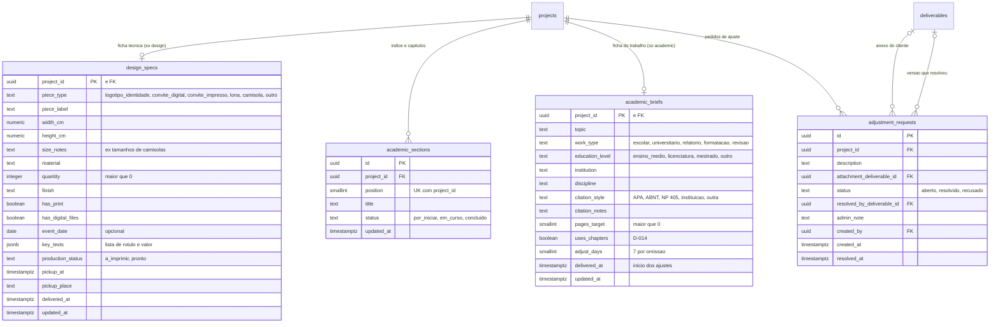

# MER — Fichas específicas de cada serviço
> Projeto: GeniusFrela — Área do Cliente multi-serviço · Tarefa: [M2-03] · Issue: #22 · Versão: 1.0 · Data: 2026-11-24
> Depende de: `mer/fases-servicos.md` (M2-01), `mer/blocos-comuns.md` (M2-02), `requisitos-funcionais.md` (RF-10, RF-20), `regras-negocio.md` · Perguntas/decisões usadas: Q-050…Q-053, D-014, D-016, D-019, D-020, D-021, D-035, D-048, D-049, D-055…D-061

## 1. O que este modelo resolve
São os dados que só existem num serviço:

| Serviço | Tabelas | Para quê |
|---|---|---|
| Académico | `academic_briefs` | Ficha do trabalho: tema, tipo, nível, instituição, normas, páginas, prazo de ajustes (RF-10.10, RF-10.70) |
| Académico | `academic_sections` | Índice e estado de cada capítulo (RF-10.30, RF-10.40, RF-10.41) |
| Académico | `adjustment_requests` | Pedidos de ajuste depois da entrega (RF-10.71…RF-10.74) |
| Design | `design_specs` | Ficha técnica, textos-chave, produção e levantamento (RF-20.10, RF-20.11, RF-20.61, RF-20.70) |

### Porquê tabelas próprias e não `projects.spec jsonb` (D-055)
| Critério | Tabela por serviço | `spec jsonb` |
|---|---|---|
| Validação | Tipos, `not null` e `check` na BD (ex.: `quantity > 0`, `adjust_days between 0 and 60`) | Só um JSON Schema na aplicação; a BD aceita qualquer JSON válido |
| Consultas e regras | Os triggers usam `has_print`, `delivered_at`, `adjust_days` diretamente | É preciso extrair campos do JSON em cada regra |
| Novo serviço | Uma tabela nova (aceitável, RNF-703) | Só um schema novo |
| Manutenção | Migração para mudar um campo | Sem migração, mas com dados antigos em formatos diferentes |

Ganha a tabela por serviço porque as fichas alimentam **regras** (prazo de ajustes, salto da produção, aviso de irreversibilidade), e essas regras precisam de dados validados. O único campo flexível é `design_specs.key_texts`, que é uma lista por natureza (D-057).

### Porquê não há `design_proofs` (D-060)
As provas e as rondas já estão no modelo da M2-02, e uma tabela à parte duplicaria esses dados:

| O que a issue pedia | Onde fica |
|---|---|
| Versão Vn da prova e os seus ficheiros | `deliverables` (`role = prova`, `series_key = prova`, `version_no`, `label`) + `files` (D-048) |
| Comentário da ronda | `approval_responses.comment` (`kind = pedir_alteracoes`) e o anexo opcional (D-049) |
| Ronda | nº de respostas `pedir_alteracoes` nas aprovações `prova` (D-053) |
| Nº de rondas incluídas | `quotes.rounds_included` do orçamento aceite (D-050) |

## 2. Diagrama
Fonte: [`../src/mer-fichas.mmd`](../src/mer-fichas.mmd) · Imagem: `../img/mer-fichas.png` *(por gerar: falta autorizar o `mermaid-cli`)*

## 3. Académico

### 3.1 `academic_briefs` — ficha do trabalho (1:1 com `projects`)
| Coluna | Tipo | Nulo | Default | Regra |
|---|---|---|---|---|
| `project_id` | uuid | não | — | **PK** e FK → `projects` on delete cascade; o projeto tem de ser `academic` (trigger) |
| `topic` | text | não | — | tema do trabalho |
| `work_type` | text | não | — | `escolar`, `universitario`, `relatorio`, `formatacao`, `revisao` (RF-10.10) |
| `education_level` | text | não | — | `ensino_medio`, `licenciatura`, `mestrado`, `outro` |
| `institution`, `discipline` | text | sim | — | |
| `citation_style` | text | sim | — | `APA`, `ABNT`, `NP 405`, `instituicao`, `outra` |
| `citation_notes` | text | sim | — | indicações das normas da instituição |
| `pages_target` | smallint | sim | — | `> 0` |
| `uses_chapters` | boolean | não | `true` | `false` em trabalhos curtos: a fase `estrutura` pode ficar não aplicável e o progresso vem de `project_phases.progress` (D-014, RF-10.43) |
| `adjust_days` | smallint | não | `7` | `between 0 and 60` (RN-33, D-016) |
| `delivered_at` | timestamptz | sim | — | preenchido quando a entrega final é disponibilizada ao cliente (o restante foi pago); **começa o prazo de ajustes** (RF-10.64) |
| `updated_at` | timestamptz | não | `now()` | |

O prazo de entrega fica em `projects.due_on`, que vem do orçamento (D-044, D-050), e não se repete aqui.

**Fim dos ajustes** = `delivered_at + adjust_days` dias (Africa/Luanda), calculado na leitura. Um job diário conclui o projeto quando esse dia passa sem pedidos `aberto` (RN-34): `projects.status = entregue`, que preenche `completed_at` e começa os 90 dias (RN-08).

### 3.2 `academic_sections` — índice e capítulos (D-058)
| Coluna | Tipo | Nulo | Default | Regra |
|---|---|---|---|---|
| `id` | uuid | não | `gen_random_uuid()` | PK |
| `project_id` | uuid | não | — | FK → `projects` on delete cascade; só projetos `academic` |
| `position` | smallint | não | — | **UK (`project_id`, `position`)**, *deferrable* para reordenar numa transação |
| `title` | text | não | — | ex.: "Capítulo 2 — Enquadramento teórico" |
| `status` | text | não | `'por_iniciar'` | `por_iniciar`, `em_curso`, `concluido` (RF-10.40) |
| `updated_at` | timestamptz | não | `now()` | |

- A tabela tem sempre o **índice atual**. Cada versão enviada ao cliente fica copiada no `snapshot` da aprovação `indice` (D-049), por isso o histórico não se perde.
- **Progresso** (RF-10.41) = capítulos `concluido` / total, calculado na leitura. A % da fase de desenvolvimento usa este valor quando `uses_chapters = true`.
- O cliente vê só o título e o estado, nunca o texto (D-015).

### 3.3 `adjustment_requests` — pedidos de ajuste (D-056)
| Coluna | Tipo | Nulo | Default | Regra |
|---|---|---|---|---|
| `id` | uuid | não | `gen_random_uuid()` | PK |
| `project_id` | uuid | não | — | FK → `projects` on delete cascade |
| `description` | text | não | — | 10 a 2000 caracteres |
| `attachment_deliverable_id` | uuid | sim | — | FK → `deliverables` (`role = referencia`) com o ficheiro opcional do cliente |
| `status` | text | não | `'aberto'` | `aberto` → `resolvido` ou `recusado` |
| `resolved_by_deliverable_id` | uuid | sim | — | FK → `deliverables`: a nova versão da entrega final (PDF + Word) que resolveu o pedido (RF-10.73) |
| `admin_note` | text | sim | — | obrigatório em `recusado`, por exemplo "é trabalho novo" (RN-32, D-035) |
| `created_by`, `created_at`, `resolved_at` | — | — | — | |

- O cliente só cria um pedido **dentro do prazo de ajustes** (trigger: `now() <= delivered_at + adjust_days`; RN-33). Fora do prazo, o portal leva às mensagens (RF-10.72).
- Um pedido `recusado` por ser trabalho novo pode dar origem a um `payments` `extra` (RN-32).
- O ficheiro anexado pelo cliente conta para o limite de 10 ficheiros da fase `ajustes`. Por isso, essa fase passa a ter `client_can_upload = true` no seed (D-061).

## 4. Design

### 4.1 `design_specs` — ficha técnica (1:1 com `projects`)
| Coluna | Tipo | Nulo | Default | Regra |
|---|---|---|---|---|
| `project_id` | uuid | não | — | **PK** e FK → `projects` on delete cascade; o projeto tem de ser `design` (trigger) |
| `piece_type` | text | não | — | `logotipo_identidade`, `convite_digital`, `convite_impresso`, `lona`, `camisola`, `outro` |
| `piece_label` | text | sim | — | ex.: "Convite do casamento — 120 unidades" |
| `width_cm`, `height_cm` | numeric(7,2) | sim | — | `> 0` |
| `size_notes` | text | sim | — | ex.: tamanhos das camisolas (10 M, 8 L) |
| `material`, `finish` | text | sim | — | |
| `quantity` | integer | não | `1` | `> 0` |
| `has_print` | boolean | não | — | com `false`, a fase `producao` passa a `nao_aplicavel` (trigger; RN-44, D-020) |
| `has_digital_files` | boolean | não | — | com `true`, a fase `entrega-levantamento` espera `deliverables` `series_key = ficheiros-finais` (RF-20.71) |
| `event_date` | date | sim | — | data do evento (RF-20.02, RF-20.74) |
| `key_texts` | jsonb | não | `'[]'` | lista ordenada `[{"label": "Noivos", "value": "Ana & Paulo"}, …]`; `check (jsonb_typeof(key_texts) = 'array')` + validação na aplicação; no máximo 20 itens (D-057) |
| `production_status` | text | sim | — | `a_imprimir`, `pronto` (RF-20.61); só com `has_print = true` |
| `pickup_at` | timestamptz | sim | — | data e hora de entrega ou levantamento (RF-20.70) |
| `pickup_place` | text | sim | — | |
| `delivered_at` | timestamptz | sim | — | marcado pelo admin (RF-20.73): o projeto passa a `entregue` |
| `updated_at` | timestamptz | não | `now()` | |

- **Aviso de irreversibilidade** (RN-42, D-021): o pedido de aprovação da arte copia para o `snapshot` os `key_texts`, a `quantity`, as medidas e a `event_date`. O que o cliente confirmou fica fixo, mesmo que a ficha mude depois.
- **Alerta do evento** (RF-20.74, Could): `pickup_at` a menos de 3 dias de `event_date`, ou depois dela, mostra um alerta ao admin. É calculado na leitura.

## 5. Regras na base de dados
| # | Regra | Como | RF / RN |
|---|---|---|---|
| F1 | `academic_briefs` e `academic_sections` só em projetos `academic`; `design_specs` só em `design` | trigger `before insert` | RN-02 |
| F2 | `design_specs.has_print = false` → fase `producao` = `nao_aplicavel`; voltar a `true` → `por_iniciar` | trigger `after insert or update of has_print` | RN-44 |
| F3 | Pedido de ajuste do cliente só dentro do prazo | trigger `before insert on adjustment_requests` | RN-33 |
| F4 | `recusado` exige `admin_note`; `resolvido` exige `resolved_by_deliverable_id` | `check` | RN-32, RF-10.73 |
| F5 | `production_status` só com `has_print = true` | `check` | RF-20.61 |
| F6 | Alterações às fichas entram no `activity_log` | trigger genérico (D-051) | RNF-308 |

## 6. Cardinalidades
| Relação | Cardinalidade |
|---|---|
| `projects` (academic) → `academic_briefs` | 1 : 0..1 (criada no briefing) |
| `projects` (academic) → `academic_sections` | 1 : 0..N |
| `projects` (academic) → `adjustment_requests` | 1 : 0..N |
| `projects` (design) → `design_specs` | 1 : 0..1 |
| `deliverables` → `adjustment_requests` (anexo / resolução) | 0..1 : 0..N |

## 7. Segurança (provisória; a matriz final é a M3-06)
| Tabela | Cliente (do seu projeto) | Admin |
|---|---|---|
| `academic_briefs` | lê | tudo |
| `academic_sections` | lê o título e o estado | tudo |
| `adjustment_requests` | lê; **insere** dentro do prazo | tudo |
| `design_specs` | lê | tudo |

## 8. Impacto no código (para a M5–M7)
- ~~Migração `0007_fichas_servico.sql`~~ → uma migração por tarefa (D-149): `0009_academic_briefs.sql` (M6-01); as outras tabelas entram com a M6-03, a M6-05 e a M7-01.
- O admin preenche a ficha no briefing (M6-01 #54, M7-01 #64). O cliente vê-a atrás de "ver detalhes" (RF-10.11, RF-20.12).
