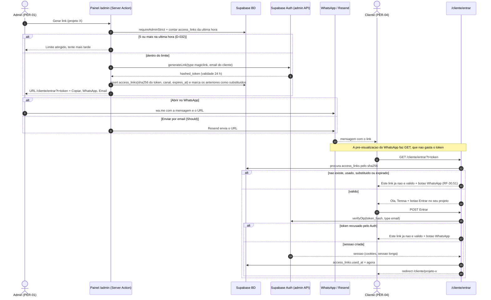
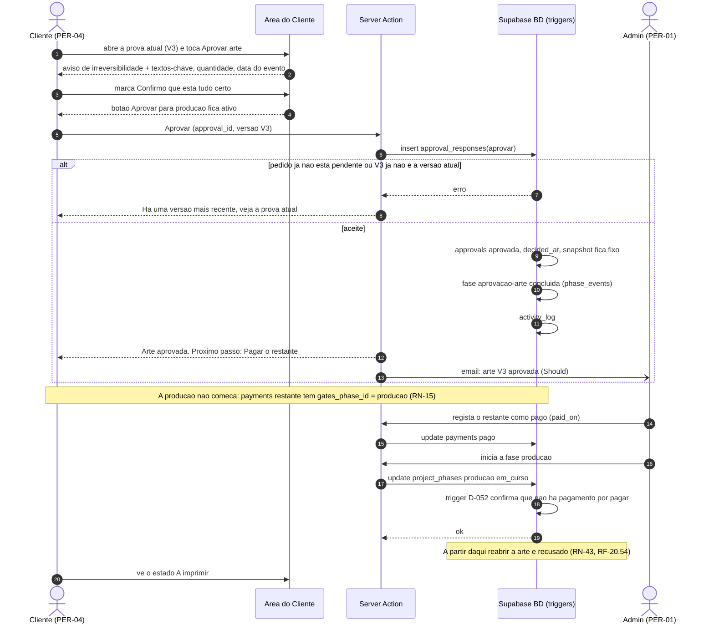

# Diagramas de sequência — link mágico e aprovação da arte
> Projeto: GeniusFrela — Área do Cliente multi-serviço · Tarefa: [M2-06] · Issue: #25 · Versão: 1.0 · Data: 2026-11-24
> Depende de: `mer/*.md`, `estados/estados.md`, `requisitos-funcionais.md` (RF-30.5, RF-20.5), `requisitos-nao-funcionais.md` (RNF-301, RNF-309) · Perguntas/decisões usadas: Q-059…Q-061, D-011, D-021, D-023, D-032, D-037, D-049, D-052, D-067…D-071
> Fontes: `../src/sequencia-link-magico.mmd`, `../src/sequencia-aprovacao-arte.mmd` · Imagens em `../img/`: por gerar (falta autorizar o `mermaid-cli`)

## 1. Link mágico

### Pontos de desenho
| # | Ponto | Porquê | Decisão |
|---|---|---|---|
| L1 | O link aponta para **o nosso** `/cliente/entrar?t=…` e não para o URL do Supabase | O fluxo no servidor (SSR) troca o `token_hash` por sessão com `verifyOtp` e grava os cookies; funciona no browser do WhatsApp (RNF-207) | D-067 |
| L2 | **GET mostra a página; só o POST do botão "Entrar" gasta o token** | As pré-visualizações do WhatsApp e alguns antivírus abrem o link sozinhos; com entrada automática gastavam o link de uso único | Q-059, D-068 |
| L3 | O token **nunca** é guardado; `access_links` guarda só o SHA-256 | O repositório é público e a BD tem backups: um token guardado seria uma credencial | D-069 |
| L4 | Gerar um link novo marca os anteriores como **substituídos** | Um só link válido por cliente, mais fácil de explicar | D-069 |
| L5 | Limite de **5 links por cliente por hora**, contado em `access_links` | RNF-309, D-032 | — |
| L6 | Link expirado, usado ou substituído → "Este link já não é válido" + **botão do WhatsApp** (sem pedido automático por email) | RF-30.51 sem alterações | Q-060 |
| L7 | Um cliente criado só com link mágico tem `must_change_password = false` | Não há senha obrigatória (RF-30.53, D-023) | D-070 |
| L8 | Validade de 24 h = `Email OTP Expiration` do projeto em 86 400 s (o máximo) | RNF-301 | D-023 |

**A confirmar no spike M3-02 (#27):** que `auth.admin.generateLink` devolve o `hashed_token` aceite por `verifyOtp`; que gerar um link novo invalida o anterior também no Auth; e quanto dura a sessão no plano gratuito (*refresh token* sem limite de tempo).

### Nova tabela `access_links` (RF-30.57)
| Coluna | Tipo | Nulo | Default | Regra |
|---|---|---|---|---|
| `id` | uuid | não | `gen_random_uuid()` | PK |
| `client_id` | uuid | não | — | FK → `clients.id` on delete cascade |
| `project_id` | uuid | não | — | FK → `projects.id` on delete cascade; projeto para onde o link leva |
| `token_digest` | text | não | — | **UK**; SHA-256 (hex) do `hashed_token`; o token nunca é guardado |
| `channel` | text | não | — | `copiar`, `whatsapp`, `email` (o último usado pelo admin) |
| `status` | text | não | `'ativo'` | `ativo` · `usado` · `substituido` (expirado = `ativo` com `expires_at` passado, calculado) |
| `expires_at` | timestamptz | não | — | `created_at + 24 h` |
| `used_at` | timestamptz | sim | — | preenchido depois de um `verifyOtp` com sucesso |
| `created_by` | uuid | sim | `auth.uid()` | FK → `auth.users.id` |
| `created_at` | timestamptz | não | `now()` | |

Só o servidor lê e escreve, com a chave secreta (o cliente não tem sessão quando abre o link). O admin lê pelo painel. Não se guarda IP nem *user agent* (RNF-4).

## 2. Aprovação da arte (Design)

### Pontos de desenho
| # | Ponto | Porquê | Decisão |
|---|---|---|---|
| A1 | O botão "Aprovar para produção" só fica ativo depois de marcar **"Confirmo que os nomes, a data e a quantidade estão certos"** | Evita toques por engano no telemóvel, sem ser pesado para a PER-04 | Q-061, D-071 |
| A2 | O aviso mostra os textos do **`snapshot`** da aprovação, não os da ficha atual | O cliente confirma exatamente o que fica registado (D-049, RN-42) | — |
| A3 | A resposta é recusada se o pedido já não estiver pendente ou se a versão já não for a atual | O admin pode ter carregado uma V4 entretanto | — |
| A4 | Aprovar **não** põe a produção em curso: o restante trava a fase `producao` (`gates_phase_id`) | RN-15, D-052 | — |
| A5 | Quando `producao` passa a `em_curso`, a resposta `reabrir` passa a ser recusada | RN-43, RF-20.54 | — |
| A6 | Tudo o que muda fica em `approval_responses`, `phase_events` e `activity_log` | RNF-308 | — |

## 3. Impacto noutros artefactos
- `access_links` entra no dicionário de dados (17 tabelas) e na migração da M5-12 (#50).
- `clients.must_change_password` passa a `false` para clientes criados sem senha (D-070), na mesma issue.
