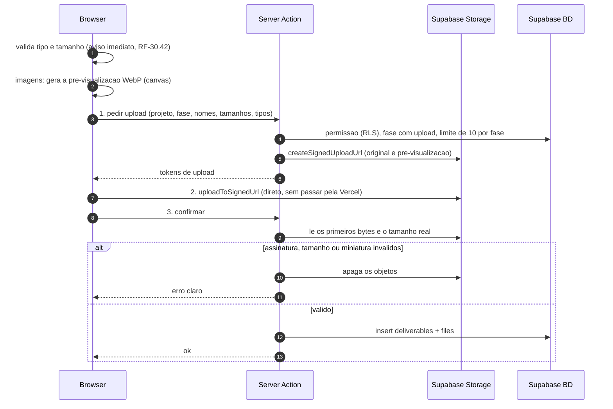

# ADR-003 — Armazenamento de ficheiros e entregáveis
> Projeto: GeniusFrela — Área do Cliente multi-serviço · Tarefa: [M3-03] · Issue: #28 · Versão: 1.0 · Data: 2026-11-24
> Depende de: `docs/02-modelagem/mer/blocos-comuns.md` §3.5–3.6, `requisitos-funcionais.md` RF-30.4, `requisitos-nao-funcionais.md` RNF-103, RNF-303…RNF-305, RNF-502…RNF-503 · Perguntas/decisões usadas: Q-021, Q-022, Q-065, Q-066, D-024, D-025, D-031, D-032, D-048, D-054, D-080…D-085

**Estado:** Aceite · **Data:** 2026-11-24

## Contexto
- Os ficheiros são privados (repositório público, trabalhos académicos e provas de clientes) e têm de caber no **1 GB** do Supabase gratuito (RNF-502).
- Os clientes usam **Android com dados móveis** (Q-010): a galeria tem de mostrar pré-visualizações leves (RNF-103).
- **Limite da Vercel:** o corpo de um pedido a uma função tem no máximo **4,5 MB**. Os ficheiros do cliente (até 10 MB) e do admin (até 50 MB) **não podem passar por uma Server Action**.

## Decisão

### 1. Dois buckets privados (D-080)
| Bucket | Quem envia | Limite do bucket | Tipos (MIME) | Caminho |
|---|---|---|---|---|
| `client-uploads` | cliente (referências, anexos de ajuste e de revisão) | **10 MB** | `image/jpeg`, `image/png`, `image/webp`, `image/heic`, `image/heif`, `application/pdf`, `application/msword`, `application/vnd.openxmlformats-officedocument.wordprocessingml.document` | `{project_id}/{deliverable_id}/{file_id}.{ext}` |
| `project-files` | admin (provas, entregáveis, ficheiros finais) | **50 MB** (máximo do plano gratuito) | os do cliente + `application/postscript` (AI/EPS), `image/vnd.adobe.photoshop` (PSD), `application/zip`, `image/svg+xml` | `{project_id}/{deliverable_id}/{file_id}.{ext}` |

Os limites ficam **no bucket**, e assim o Storage recusa sozinho um ficheiro grande ou de outro tipo, mesmo que alguém contorne o browser (RNF-305). Nenhum dos dois buckets é público. O bucket `project-covers`, que é público, continua só para as capas.

### 2. Upload direto em 3 passos (D-081)

- O passo 3 verifica a **assinatura do ficheiro** (os primeiros bytes) contra uma tabela própria e não confia na extensão nem no `Content-Type`. Exemplos: `%PDF` em PDF/AI, `FF D8 FF` em JPEG, `89 50 4E 47` em PNG, `RIFF…WEBP` em WebP, `ftypheic`/`ftypmif1` em HEIC, `PK 03 04` + `[Content_Types].xml` em DOCX, `D0 CF 11 E0` em DOC, `8BPS` em PSD (D-084).
- Um upload sem confirmação é um **órfão**. A limpeza diária (§4) apaga os objetos com mais de 24 h sem linha em `files`.

### 3. Pré-visualizações geradas no browser (Q-065, D-082)
| Origem | O que o browser faz | O que fica no Storage |
|---|---|---|
| **Prova do admin** (JPG/PNG/WebP) | **Não mexe no original**; gera uma pré-visualização WebP com 1600 px no lado maior e até 150 KB | original intacto + `…/preview.webp` |
| **Referência do cliente** (foto) | Fotos acima de 2 MB são reduzidas a 2560 px (JPEG/WebP, qualidade 0,85) **antes** de enviar, para poupar dados móveis; gera a mesma pré-visualização | foto reduzida + `…/preview.webp` |
| HEIC, PDF, DOC/DOCX, AI, PSD, ZIP | nada | original; a galeria mostra um ícone do tipo |

- Se o browser não conseguir ler a imagem (ex.: HEIC no Chrome Android), envia só o original, sem pré-visualização.
- O servidor **valida sempre** a pré-visualização: tem de ser `RIFF…WEBP`, ter até 150 KB e no máximo 1600 px. Uma pré-visualização inválida é apagada e a versão fica sem ela.
- `files.thumb_path` aponta para a pré-visualização. A galeria e a "última prova em grande" usam-na; o original só se descarrega a pedido (RF-20.83, RF-30.46).

### 4. Leitura e limpeza
- **Download:** URL assinada gerada no servidor com validade de **15 minutos** (D-083, dentro dos ≤ 1 h de RNF-303), depois de verificar a RLS, que a versão não está bloqueada por pagamento (RNF-304) e que não foi apagada (`purged_at`).
- **Limpeza diária** (Q-066, D-085): `/api/cron/limpeza` no **Vercel Cron**, protegida pelo `CRON_SECRET` como o keepalive, uma vez por dia:
  1. avisa o admin dos projetos que chegam aos **83 dias** depois da conclusão (7 dias antes, RN-08);
  2. apaga do Storage os ficheiros dos projetos com **≥ 90 dias** (o admin pode **adiar 30 dias**, repetível — corrigido pela D-146, Q-091), preenche `purged_at` e regista `purge` no `activity_log`;
  3. apaga os uploads **órfãos** com mais de 24 h;
  4. conclui os projetos Académico cujo prazo de ajustes terminou sem pedidos abertos (D-059).

### 5. Estimativa de uso face a 1 GB
| Tipo de projeto | Referências | Provas / versões | Ficheiros finais | Pré-visualizações | Total típico |
|---|---|---|---|---|---|
| Académico | ~5 MB | 3 versões PDF + Word ≈ 9 MB | (incluído) | — | **~15 MB** |
| Design (convite, lona) | ~10 MB | 3 versões × 2 imagens × 3 MB ≈ 18 MB | AI/PDF ≈ 20 MB | ~1 MB | **~50 MB** |
| Desenvolvimento | ~2 MB | — | — | — | **~2 MB** |

Com a retenção de 90 dias, o Storage guarda os projetos ativos e os concluídos há menos de 90 dias. Com **8 Design + 8 Académico** nessa janela: 8 × 50 + 8 × 15 ≈ **520 MB (52%)**. O gatilho de 80% (RNF-505, ~800 MB) chega com cerca de **14 Design + 10 Académico** ao mesmo tempo. Um ZIP final de 50 MB ocupa 5% sozinho, por isso ficheiros finais muito grandes devem ir por um link externo (ex.: Google Drive) registado nas notas da versão.

## Alternativas consideradas
| Alternativa | Porque não |
|---|---|
| Upload pela Server Action | O limite de 4,5 MB da Vercel corta os ficheiros de 10 MB e de 50 MB |
| Um só bucket com os limites do admin | Um cliente que contornasse o browser podia enviar 50 MB ou um ZIP; com dois buckets, o Storage impõe os limites do cliente |
| Miniaturas no servidor com `sharp` | Mais controlo, mas gasta tempo e memória das funções e obriga a descarregar cada imagem; o cliente ainda enviava fotos de 8 MB com dados móveis (Q-065) |
| Image Transformations do Supabase | Só nos planos pagos |
| pg_cron + Edge Function | Mais uma peça para manter; o Vercel Cron já existe (Q-066) |

## Consequências
- **Positivas:** uploads de qualquer tamanho até ao limite, sem passar pela Vercel; o cliente gasta menos dados; os limites do cliente são impostos pelo Storage; a galeria carrega pré-visualizações de ≤ 150 KB.
- **Negativas / riscos:**
  - **R-07 — capas em produção:** `project-covers` aceita 5 MB, mas a capa é enviada por uma Server Action (`bodySizeLimit: "6mb"`) e a Vercel corta a 4,5 MB. Uma capa entre 4,5 e 5 MB falha hoje. Corrigir na M5 com o mesmo upload direto, ou baixar o limite do bucket para 4 MB.
  - A qualidade das pré-visualizações depende do browser; o original fica sempre disponível.
  - O cron diário do plano Hobby só corre uma vez por dia, por isso um órfão pode ficar até ~48 h.
- **Testes (M5-09, #47):** ficheiro renomeado (`.pdf` que é um `.exe`) → recusado; 11 MB no bucket do cliente → recusado pelo Storage; upload sem confirmação → apagado pela limpeza; versão bloqueada → sem URL assinada; URL assinada expirada → erro.

## RNF relacionados
RNF-103 (pré-visualizações ≤ 150 KB) · RNF-105 (progresso e falhas por ficheiro) · RNF-303 (URL assinada) · RNF-304 (bloqueio por pagamento) · RNF-305 (validação no servidor e no bucket) · RNF-404 (90 dias) · RNF-502/503 (Storage e tamanho máximo)
