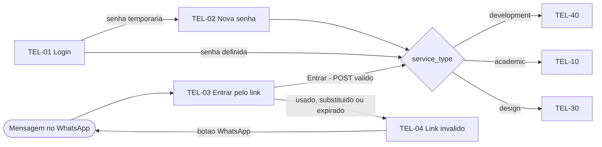
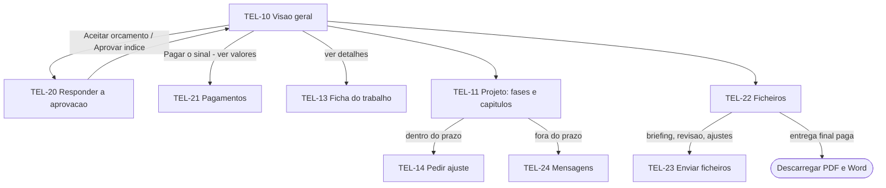
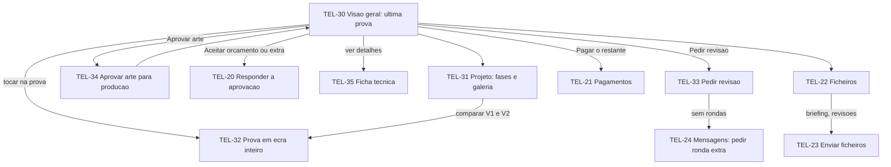
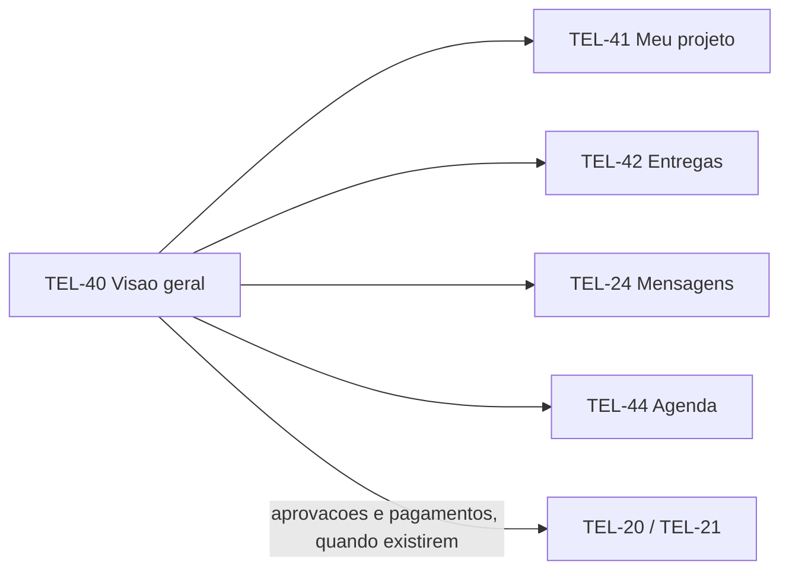
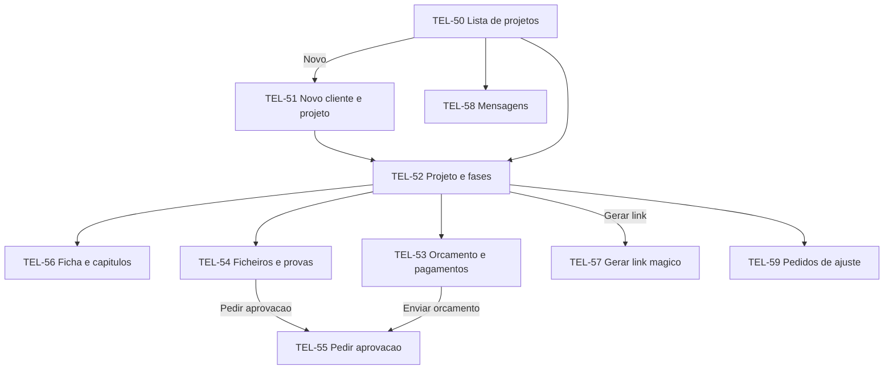

# Fluxo de telas por serviço
> Projeto: GeniusFrela — Área do Cliente multi-serviço · Tarefa: [M4-02] · Issue: #33 · Versão: 1.0 · Data: 2026-11-24
> Depende de: **Design System V1** (ADR-004), `docs/03-arquitetura/layout-blocos.md` (blocos, navegação), `user-stories.md`, ADR-002, ADR-003 · Decisões usadas: D-068, D-071, D-092, D-093, D-096, D-105, D-106

## Convenções
- **TEL-0x** acesso e conta · **TEL-1x** Académico · **TEL-2x** comuns aos 3 serviços · **TEL-3x** Design · **TEL-4x** Tech (já existem) · **TEL-5x** admin.
- **Página** = rota própria; **folha** = painel que sobe de baixo no telemóvel (*bottom sheet*) e abre como painel lateral no computador; **separador** = secção dentro de uma página do admin (D-105).
- A navegação principal é a barra inferior (telemóvel) ou lateral (computador) com as entradas do serviço (D-092, D-093). As folhas fecham com "voltar" do Android.
- A lista e a ligação a US e RF são geradas por `scripts/gerar_us.py` (`TELAS`, `US_TEL`), que falha se uma TEL ficar sem US; a coluna TEL de `rastreabilidade.md` sai daí.

## 1. Lista de telas (35)
| TEL | Nome | Serviço | Tipo | Conteúdo / blocos | US |
|---|---|---|---|---|---|
| TEL-01 | Login (email + senha) | Todos | página | já existe (`/cliente/login`); alternativa ao link (RF-30.55) | US-003 |
| TEL-02 | Nova senha (1.º acesso) | Todos | página | já existe (`/cliente/nova-senha`); só para quem entrou com senha temporária | US-003 |
| TEL-03 | Entrar pelo link mágico | Todos | página | `/cliente/entrar?t=…`: logótipo vertical, "Olá, <nome>", botão **Entrar** (POST) — ADR-002 | US-003 |
| TEL-04 | Link inválido ou expirado | Todos | página | "Este link já não é válido" + botão WhatsApp (RF-30.51) | US-003 |
| TEL-05 | Seletor de projetos | Todos | folha | lista de projetos com o chip do serviço (cor do módulo) | US-006 |
| TEL-06 | Definições da conta | Todos | página | definir senha opcional (RF-30.54), sair | US-003 |
| TEL-10 | Visão geral — Académico | Académico | página `/cliente` | `aca-countdown` · `next-step` · `approvals` · `payments` · `aca-brief` | US-004, US-011, US-021, US-023 |
| TEL-11 | Projeto — Académico | Académico | página `/cliente/projeto` | `phase-bar` · `aca-chapters` · `aca-adjustments` | US-025, US-026 |
| TEL-13 | Ficha do trabalho | Académico | folha (ver detalhes) | `aca-brief` completo | US-022 |
| TEL-14 | Pedir ajuste | Académico | folha | descrição + anexo opcional; dias restantes (RPC `request_adjustment`) | US-027 |
| TEL-20 | Responder a uma aprovação | Todos | folha | pedido com o `snapshot` (orçamento, índice, extra, entrega): **Aprovar** / Pedir alterações (RPC `respond_approval`) | US-012, US-013, US-024 |
| TEL-21 | Pagamentos | Todos | folha (ver detalhes) | `payments`: total, pago, em falta, lista com estados | US-010 |
| TEL-22 | Ficheiros | Todos | página `/cliente/entregas` | `files`: séries e versões; cadeado nas bloqueadas; rótulo "Ficheiros" (Académico, Design) ou "Entregas" (Tech) | US-017, US-026 |
| TEL-23 | Enviar ficheiros | Académico, Design | folha | escolher ficheiros, limites, progresso por ficheiro (ADR-003) | US-015 |
| TEL-24 | Mensagens | Todos | página `/cliente/mensagens` | já existe; mensagem geral ou sobre uma fase; aviso fora de horário (RF-30.63) | US-019 |
| TEL-30 | Visão geral — Design | Design | página `/cliente` | `des-latest-proof` · `des-rounds` · `next-step` · `des-pickup` · `approvals` · `payments` · `des-spec` | US-004, US-011, US-021, US-030, US-035, US-036 |
| TEL-31 | Projeto — Design | Design | página `/cliente/projeto` | `phase-bar` · `des-gallery` | US-031 |
| TEL-32 | Prova em ecrã inteiro / comparar | Design | página/folha | prova em ecrã inteiro; comparar duas versões (uma por cima da outra no telemóvel) | US-031 |
| TEL-33 | Pedir revisão | Design | folha | comentário obrigatório + imagem opcional; "Ronda X de N"; sem rondas → "Pedir ronda extra" | US-032, US-033 |
| TEL-34 | Aprovar arte para produção | Design | folha | aviso de irreversibilidade + textos-chave do `snapshot` + caixa "Confirmo" + **Aprovar para produção** (D-071) | US-034 |
| TEL-35 | Ficha técnica | Design | folha (ver detalhes) | `des-spec` completo | US-029 |
| TEL-40 | Visão geral — Tech | Tech | página `/cliente` | já existe, sem mudanças de comportamento (blocos `tech-*`) | US-004, US-008 |
| TEL-41 | Meu projeto — Tech | Tech | página `/cliente/projeto` | já existe: Etapas · Tarefas · Demonstração | US-008 |
| TEL-42 | Entregas — Tech | Tech | página `/cliente/entregas` | já existe | US-008 |
| TEL-44 | Agenda — Tech | Tech | página `/cliente/agenda` | já existe; nos outros serviços redireciona para `/cliente` (D-096) | US-008 |
| TEL-50 | Admin: lista de projetos | Admin | página `/admin` | lista com serviço, fase atual, próximo passo, alertas (90 dias, evento próximo) | US-018 |
| TEL-51 | Admin: novo cliente e projeto | Admin | página | cliente + projeto; **tipo de serviço**; repositório só no Tech; senha ou só link | US-001 |
| TEL-52 | Admin: projeto e fases | Admin | página `/admin/projetos/[id]` | fases (estado, próximo passo, datas), estado do projeto (pausar, cancelar, reabrir) | US-005, US-007, US-028, US-036 |
| TEL-53 | Admin: orçamento e pagamentos | Admin | separador | orçamento (versões), pagamentos (registar, marcar pago), extras | US-009, US-033, US-035 |
| TEL-54 | Admin: ficheiros e provas | Admin | separador | carregar versões (provas, entregáveis), bloqueio por pagamento | US-016 |
| TEL-55 | Admin: pedir aprovação | Admin | folha | pedir aprovação de uma versão; reabrir com motivo | US-012, US-013, US-014 |
| TEL-56 | Admin: ficha e capítulos | Admin | separador | ficha do trabalho / ficha técnica; capítulos (ordenar, estado) | US-022, US-024, US-029 |
| TEL-57 | Admin: gerar link mágico | Admin | folha | gerar link: Copiar · Abrir no WhatsApp · Enviar por email (≤ 2 cliques) | US-002 |
| TEL-58 | Admin: mensagens | Admin | página `/admin/mensagens` | já existe | US-019 |
| TEL-59 | Admin: pedidos de ajuste | Admin | separador (Académico) | pedidos de ajuste: resolver com nova versão ou recusar com nota | US-027 |

### Variações por `service_type`
| Rota | Tech (`development`) | Académico (`academic`) | Design (`design`) |
|---|---|---|---|
| `/cliente` | TEL-40 | TEL-10 | TEL-30 |
| `/cliente/projeto` | TEL-41 | TEL-11 | TEL-31 |
| `/cliente/entregas` | TEL-42 ("Entregas") | TEL-22 ("Ficheiros") | TEL-22 ("Ficheiros") |
| `/cliente/mensagens` | TEL-24 | TEL-24 | TEL-24 |
| `/cliente/agenda` | TEL-44 | → `/cliente` | → `/cliente` |
| Folhas comuns | TEL-20, TEL-21, TEL-22 | TEL-20, TEL-21, TEL-23, TEL-13, TEL-14 | TEL-20, TEL-21, TEL-23, TEL-32…TEL-35 |
| Cor (`data-service`) | Azul Sistema | Âmbar Saber | Lilás Criativo |

## 2. Entrada (link mágico ou senha)

## 3. Académico

## 4. Design

## 5. Tech (sem alterações de fluxo)

## 6. Admin

## 7. Regras de navegação
1. **Cada ação do cliente abre uma folha** (TEL-14, 20, 23, 33, 34), não uma página nova: o cliente não perde o contexto e o "voltar" fecha a folha (D-106).
2. **O botão principal de TEL-10/TEL-30 é sempre o próximo passo** (`next-step`); as outras ações ficam como secundárias ou em "ver detalhes" (RNF-202).
3. **Depois de uma ação**, o cliente volta à Visão geral com uma confirmação curta (ex.: "Arte aprovada. Próximo passo: pagar o restante").
4. **Links profundos:** os emails e as mensagens do WhatsApp apontam para a TEL certa (ex.: `/cliente?aprovar=<id>` abre a TEL-20).
