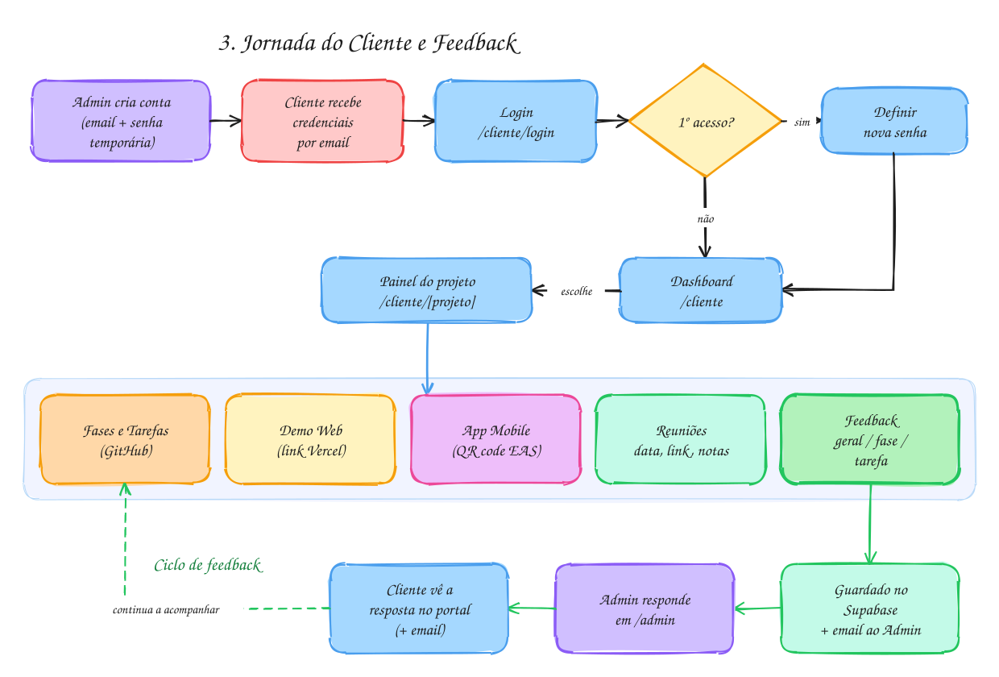
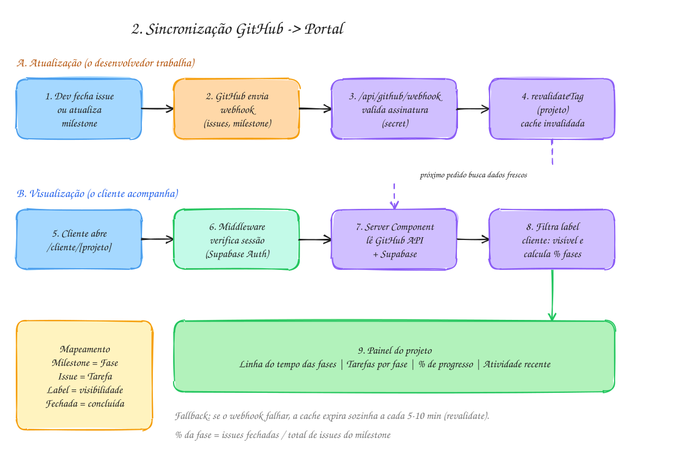
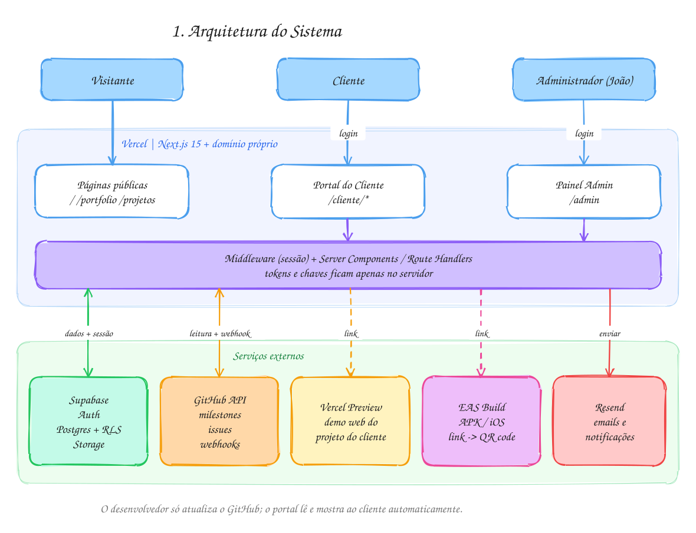
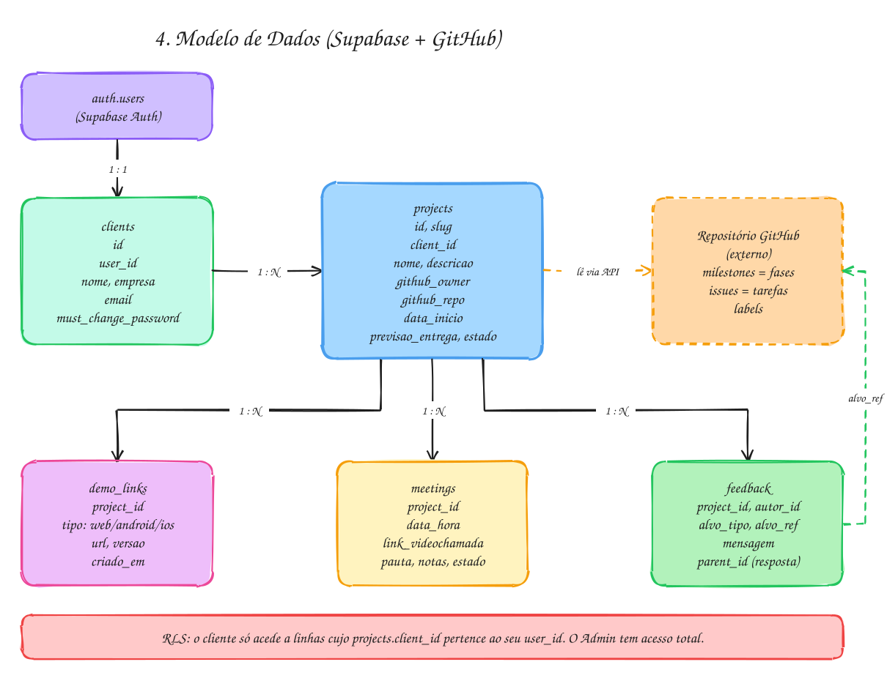

# Especificação — Portfólio & Portal do Cliente

> **Versão:** 1.2 (questões em aberto respondidas, alinhado com o método do Candongueiro Pay) · **Data:** 17/11/2026 · **Estado:** Validado para implementação
> **Base:** `docs/descricao_projeto.txt`, `docs/questoes em aberto e respostas.txt` e o repositório `lemosGit/candongueiro_pay` (roteiro M0–M10)

---

## 1. Visão geral

O portfólio atual (Next.js 15), já publicado em **https://joao-pereira.dev**, passa a ter duas vertentes no **mesmo projeto e no mesmo domínio**:

1. **Portfólio público** — apresenta trabalhos resumidos, competências e contacto.
2. **Portal do Cliente** — área autenticada onde cada cliente acompanha os projetos que estão a ser desenvolvidos para ele: fase atual, tarefas, reuniões, demonstrações e feedback.

O acompanhamento é alimentado pelo **GitHub** (milestones e issues), que é a fonte única de verdade da gestão do desenvolvimento. O portal apenas **lê e traduz** essa informação para uma linguagem que o cliente entende.

### 1.1 Objetivos

| # | Objetivo | Benefício |
|---|----------|-----------|
| O1 | Transparência sobre o progresso do projeto | Reduz pedidos de "ponto de situação" e aumenta a confiança do cliente |
| O2 | Centralizar demonstrações (web e mobile) | O cliente testa sempre a versão mais recente sem pedir links |
| O3 | Canal de feedback estruturado | Opiniões ficam associadas à fase/tarefa certa, sem se perderem em mensagens |
| O4 | Reaproveitar o fluxo de trabalho já existente no GitHub | Zero trabalho duplicado: atualizar o GitHub atualiza o portal |
| O5 | Valorizar o portfólio profissional | Demonstra metodologia e organização a potenciais clientes |

### 1.2 Fora de âmbito (v1)

- Chat em tempo real (substituído por mensagens assíncronas).
- Integração com calendários (Google Calendar, Cal.com) — as reuniões são marcadas manualmente.
- Pagamentos, faturação ou propostas comerciais.
- Registo público de clientes (contas criadas apenas pelo administrador).

---

## 2. Perfis de utilizador

| Perfil | Descrição | Acesso |
|--------|-----------|--------|
| **Visitante** | Qualquer pessoa que visita o site | Portfólio público e demos públicas |
| **Cliente** | Pessoa/empresa com **um ou mais** projetos em curso | Portal do Cliente — apenas os **seus** projetos |
| **Administrador** | João Pereira (desenvolvedor) | Tudo: clientes, projetos, demos, reuniões e respostas |

---

## 3. Estrutura de navegação

Domínio: **`joao-pereira.dev`** (já em produção na Vercel). As rotas novas são acrescentadas ao mesmo projeto Next.js; o portfólio atual em `/` não muda de endereço.

```
PÚBLICO
/                                Portfólio (página única: hero, trabalhos, percurso, contacto)  ✔ existe
/candongueiro_pay                Demo web do Candongueiro Pay (proxy para o GitHub Pages)       ✔ existe
/projetos/[slug]                 Detalhe de um trabalho (opcional, fase 2)                       ○ futuro

PORTAL DO CLIENTE
/cliente/login                   Login                                                           ✔ feito
/cliente/nova-senha              Troca obrigatória da senha temporária                           ✔ feito
/cliente                         Se tiver 1 projeto → visão geral; se tiver vários → lista       ◐ só 1 projeto
/cliente/[projeto]               Visão geral do projeto                                          ○ por fazer
/cliente/[projeto]/fases         Fases e tarefas (hoje /cliente/projeto)                         ◐ sem [projeto]
/cliente/[projeto]/entregas      Demo web + QR da app (hoje /cliente/entregas)                   ◐ sem [projeto]
/cliente/[projeto]/agenda        Reuniões (hoje /cliente/agenda)                                 ◐ sem [projeto]
/cliente/[projeto]/mensagens     Feedback (hoje /cliente/mensagens)                              ◐ sem [projeto]
/cliente/sair                    Termina a sessão                                                ✔ feito

ADMINISTRAÇÃO
/admin                           Clientes, projetos, demos, reuniões, respostas                  ○ por fazer (hoje: npm run portal)
/api/keepalive                   Cron diário que evita a pausa do Supabase Free                  ✔ feito
/api/github/webhook              Invalida a cache quando o GitHub muda                           ✔ feito
```

Legenda: ✔ feito · ◐ feito parcialmente · ○ por fazer

**Navbar pública:** links de secção do portfólio + botão **"Área do cliente"** (✔ feito).

---

## 4. Metodologia → Fases do projeto

### 4.1 As seis fases que o cliente vê

| # | Fase (nome oficial) | O que o cliente recebe |
|---|---------------------|------------------------|
| 1 | **Descoberta & Requisitos** | Requisitos priorizados (MoSCoW), personas, âmbito acordado |
| 2 | **Design (UI/UX)** | Fluxo de telas, protótipo Figma, design system |
| 3 | **Desenvolvimento** | Demo web atualizada, builds da app |
| 4 | **Testes & Validação** | Versão de homologação, lista de correções |
| 5 | **Entrega & Publicação** | Sistema em produção, lojas de apps, manuais |
| 6 | **Suporte & Manutenção** | Correções e melhorias pós-entrega |

### 4.2 Como os milestones do GitHub se ligam às fases

No GitHub, o trabalho está organizado no **roteiro de engenharia M0–M10** (ver `docs/roteiro-engenharia-de-sistemas.md` no Candongueiro Pay). São 11 milestones técnicos, demasiado detalhados para o cliente, por isso o portal **agrupa-os** nas 6 fases:

| Fase do cliente | Milestones do roteiro |
|-----------------|-----------------------|
| 1. Descoberta & Requisitos | `M0 — Setup & Governança` · `M1 — Levantamento de Requisitos` · `M2 — Análise & Modelagem` · `M3 — Arquitetura & Stack` |
| 2. Design (UI/UX) | `M4 — UX/UI Design` |
| 3. Desenvolvimento | `M5 — Backend-1: Fundação` · `M6 — Backend-2: Módulos de negócio` · `M7 — Frontend-1: Telas primordiais` · `M8 — Frontend-2: Mobile` |
| 4. Testes & Validação | `M9 — Integração & QA` |
| 5. Entrega & Publicação | `M10 — Deploy & Entrega` |
| 6. Suporte & Manutenção | `M11 — Suporte & Manutenção` (criado depois da entrega) |

- **Regra de ligação:** o portal lê o prefixo `Mx` do título do milestone e aplica a tabela acima. Assim, qualquer projeto novo que siga o roteiro fica ligado sem configuração.
- **Exceções:** um projeto que não siga o roteiro pode ter um mapa próprio, guardado no Supabase (`projects.phase_map`, ver §8.1).
- **Milestones sem prefixo `Mx`** são ignorados pelo portal.

### 4.3 Estado e progresso de cada fase

- **Progresso (%)** = issues fechadas ÷ total de issues de **todos** os milestones da fase. Conta todas as issues, visíveis ou não, para que a percentagem reflita o trabalho real.
- **Concluída** — todos os milestones da fase estão fechados **ou** não têm issues abertas.
- **Em curso** — pelo menos uma issue fechada ou em curso, e ainda há issues abertas.
- **Pendente** — nenhuma atividade ainda.
- **Fase atual** — a primeira fase não concluída. Como no roteiro algumas fases correm em paralelo (por exemplo, M7 com M6), pode haver **mais do que uma fase "em curso"**. Todas aparecem como "em curso" no roadmap, mas o destaque vai para a primeira por concluir (fechar uma tarefa avulsa da entrega, como a demo M10-01, não faz o projeto "saltar" para essa fase).
- **Data prevista** — o `due_on` mais tardio dos milestones da fase, se existir.

---

## 5. Funcionalidades do Portal do Cliente

### 5.1 Autenticação ✔

- O administrador cria a conta do cliente (**email + senha temporária**) com `npm run portal -- cliente …`. As credenciais são enviadas ao cliente por um canal privado.
- No primeiro acesso, o cliente é obrigado a **definir uma nova senha** (`/cliente/nova-senha`).
- **Recuperação de senha:** hoje é por pedido ao administrador; a recuperação automática por email chega com o Resend.
- **Sessão:** protegida pelo middleware. Cada cliente vê **apenas** os seus projetos (Row Level Security, testado com 15 casos).

### 5.2 Vários projetos por cliente

Um cliente pode ter **vários projetos em simultâneo**. O modelo de dados já o permite; falta adaptar a interface:

- **1 projeto** → `/cliente` abre diretamente a visão geral desse projeto (comportamento atual).
- **Vários projetos** → `/cliente` mostra a lista com nome, fase atual, % de progresso e próxima reunião. A barra lateral ganha um **seletor de projeto**.
- Todas as páginas passam a ter o projeto no endereço (`/cliente/[projeto]/…`), para que um link enviado ao cliente abra sempre o projeto certo.

### 5.3 Painel do projeto

| Secção | Conteúdo | Origem dos dados | Estado |
|--------|----------|------------------|--------|
| **Resumo** | Nome, descrição, início, previsão de entrega, fase atual, % global | Supabase + GitHub | ✔ UI (mock) |
| **Fases** | As 6 fases com estado, % e data prevista | GitHub (milestones agrupados) | ✔ |
| **Tarefas** | Tarefas visíveis de cada fase: título, estado, data de conclusão | GitHub (issues `cliente: visível`) | ✔ |
| **Demo web** | Link da versão mais recente (Vercel ou GitHub Pages) | Supabase (registado pelo admin) | ✔ |
| **App mobile** | **QR code** do build mais recente do EAS + link direto | Supabase (link do EAS) | ✔ |
| **Reuniões** | Próxima reunião (data, hora, link) e histórico com pauta/notas | Supabase (**marcação manual**) | ✔ |
| **Mensagens** | Feedback do cliente (geral, por fase ou por tarefa) e respostas | Supabase | ✔ |
| **Atividade recente** | Últimas tarefas concluídas | GitHub | ✔ |
| **Precisa de si** | Tarefas à espera de informação do cliente | GitHub (`estado: precisa-info`) | ✔ |

### 5.4 Reuniões (marcação manual)

- O administrador marca cada reunião à mão: hoje com `npm run portal -- reuniao …`, mais tarde em `/admin`.
- Campos: título, início e fim (hora de Luanda), link da videochamada, pauta e notas pós-reunião.
- O cliente pode adicionar a reunião ao seu calendário através de um ficheiro `.ics` gerado pelo portal (✔ feito). Não há sincronização com calendários externos.

### 5.5 Feedback (mensagens assíncronas)

- O cliente escreve uma mensagem **geral**, **sobre uma fase** (1–6) ou **sobre uma tarefa** (nº da issue).
- O administrador responde (hoje com `npm run portal -- responder`, mais tarde em `/admin`), e o cliente vê a resposta no portal.
- **Notificação por email** (Resend) ao administrador quando há mensagem nova e ao cliente quando há resposta — por fazer.

### 5.6 Jornada do cliente



1. O administrador cria a conta e envia as credenciais ao cliente.
2. No primeiro login, o cliente define uma nova senha e entra no portal.
3. No portal, o cliente acede a cinco módulos: fases e tarefas, demo web, app mobile, reuniões e mensagens.
4. **Ciclo de feedback:** a mensagem do cliente fica guardada no Supabase → o administrador responde → o cliente vê a resposta (e, quando houver Resend, recebe um email).

### 5.7 Sugestões para versões seguintes

- **Aprovações formais** — o cliente aprova uma fase (ex.: design) com um clique, ficando registadas a data e a hora. Encaixa nos *gates* de cada milestone do roteiro.
- **Ficheiros & documentos** — requisitos, contratos, manuais (Supabase Storage).
- **Changelog por versão** — notas de cada build em linguagem não técnica.
- **Pedidos de alteração** — o cliente submete um pedido que, depois de aprovado pelo administrador, vira issue no GitHub.

---

## 6. Integração com o GitHub

### 6.1 Convenções do repositório (as que já usa)

O portal segue as convenções do **roteiro de engenharia** já aplicado no Candongueiro Pay. Não há uma forma nova de trabalhar; acrescenta-se apenas **uma label**.

| Elemento | Convenção | Uso pelo portal |
|----------|-----------|-----------------|
| **Repositório** | Na conta pessoal `lemosGit`, um por projeto, normalmente **privado** | `projects.github_owner` + `github_repo` |
| **Milestones** | `M0 — Setup & Governança` … `M10 — Deploy & Entrega` (+ `M11 — Suporte & Manutenção`) | Agrupados nas 6 fases (§4.2) |
| **Issues** | Título `[Mx-NN] Verbo + objeto`, modelo `task.md`/`bug.md` | O portal mostra o título **sem** o código `[Mx-NN]` |
| **Labels de grupo** | `tipo:`, `area:`, `prioridade:`, `tamanho:`, `persona:`, `ferramenta:`, `entrega:` | Internas, não são mostradas ao cliente |
| **Labels de estado** | `estado: bloqueado`, `estado: precisa-info`, `estado: em-revisão` | Traduzidas para o cliente (ver abaixo) |
| **Quadro** | GitHub Projects "Gestão": Backlog → Pronto → Em curso → Em revisão → Feito | Opcional (§6.3) |
| **Nova label** | **`cliente: visível`** (segue o padrão `grupo: valor`) | Só as issues com esta label aparecem na lista de tarefas |

**Que issues marcar como `cliente: visível`?** As que o cliente reconhece como resultado: telas, funcionalidades, entregas, aprovações. Ficam de fora tarefas internas como setup, ADRs, CI e refactors. Elas continuam a contar para a % da fase.

### 6.2 Estado de cada tarefa (como o cliente o vê)

| No GitHub | No portal |
|-----------|-----------|
| Issue fechada | **Concluída** (com a data de fecho) |
| Aberta com `estado: em-revisão` | **Em revisão** |
| Aberta e atribuída a alguém (*assignee*) | **Em curso** |
| Aberta com `estado: precisa-info` | **Precisa de si** — destacada no topo do painel |
| Aberta com `estado: bloqueado` | **Em espera** (sem expor o motivo técnico) |
| Restantes | **Por fazer** |

### 6.3 Leitura dos dados

- **API:** GitHub REST API no servidor (Server Components / Route Handlers do Next.js). O token **nunca** chega ao browser.
- **Token:** *Fine-grained Personal Access Token* da conta `lemosGit`:
  - **Repository access:** *Only select repositories*. Escolher os repositórios dos clientes, começando pelo `candongueiro_pay`.
  - **Permissions:** *Issues: Read-only* e *Metadata: Read-only*.
  - Guardado como `GITHUB_TOKEN` no `.env.local` e na Vercel.
  - É necessário porque os repositórios são **privados**.
- **Quadro (Projects v2), opcional:** para ler as colunas do quadro, o token precisa também de acesso de leitura a projetos. Na v1, o estado vem das labels e do *assignee* (§6.2), que chegam para o cliente.
- **Cache:** `revalidate` de 10 minutos por projeto (tag `gh:<owner>/<repo>`). O webhook (§6.4) torna a atualização imediata.
- **Limites:** com token, 5000 pedidos/hora. Um projeto com cerca de 100 issues precisa de 1 pedido para os milestones e de 1 a 2 páginas de issues.

### 6.4 Fluxo de sincronização



- **A — Atualização:**
  1. Fecha uma issue ou altera um milestone, e o GitHub envia um webhook (eventos `issues` e `milestone`).
  2. A rota `/api/github/webhook` valida a assinatura (`GITHUB_WEBHOOK_SECRET`).
  3. A rota chama `revalidateTag` desse repositório.
- **B — Visualização:**
  1. No pedido seguinte, o servidor volta a buscar os milestones e as issues.
  2. Agrupa-os nas 6 fases, calcula as percentagens e filtra as issues `cliente: visível`.
  3. Mostra o painel.
- **Fallback:** se o webhook falhar, a cache expira sozinha ao fim de 10 minutos.

---

## 7. Demonstrações: Vercel, GitHub Pages e EAS

| Plataforma | Uso | Como chega ao portal |
|------------|-----|----------------------|
| **Vercel** (Hobby) | Preview da versão web | O administrador regista o URL (`npm run portal -- demo --tipo web`) |
| **GitHub Pages** | Demo estática (caso do Candongueiro Pay: `joao-pereira.dev/candongueiro_pay`) | Igual: registado como demo `web` |
| **EAS Build** (Expo) | Build Android (APK) / iOS interno | O administrador regista o URL do build e o portal gera o **QR code** |

> Em iOS, a instalação direta exige o dispositivo registado (ad hoc) ou o TestFlight. Em Android, o link do EAS instala o APK diretamente.

---

## 8. Arquitetura técnica

> Os diagramas estão em `docs/diagramas/`. Os `.svg` aparecem aqui; os `.excalidraw` podem ser editados em [excalidraw.com](https://excalidraw.com) ou com a extensão Excalidraw do VS Code.



- **Três tipos de utilizador** entram pelo mesmo site: o visitante vê as páginas públicas; o cliente e o administrador passam pelo login.
- **Toda a lógica corre no servidor do Next.js** (Middleware, Server Components, Server Actions e Route Handlers). O browser nunca recebe o token do GitHub nem a chave secreta do Supabase.
- **Serviços externos:**
  - **Supabase** guarda utilizadores e dados.
  - **GitHub** fornece o progresso.
  - **Vercel, GitHub Pages e EAS** são apenas links registados.
  - **Resend** envia os emails.

| Camada | Tecnologia | Estado |
|--------|-----------|--------|
| Frontend / SSR | Next.js 15 (App Router), React 19, TypeScript, Tailwind, Framer Motion | ✔ |
| Autenticação | Supabase Auth (email + senha) com `@supabase/ssr` e middleware | ✔ |
| Base de dados | Supabase Postgres (plano **Free**) com Row Level Security | ✔ migração pronta |
| Disponibilidade | Cron diário da Vercel (`/api/keepalive`) contra a pausa do plano Free | ✔ |
| Cópias de segurança | GitHub Action semanal, `pg_dump` cifrado (o repositório do portfólio é público) | ✔ |
| Dados de progresso | GitHub REST API + webhook | ✔ |
| Emails | Resend | ○ |
| Alojamento | Vercel + `joao-pereira.dev` | ✔ |

### 8.1 Modelo de dados (Supabase)

Conforme `supabase/migrations/0001_portal.sql`:

| Tabela | Campos principais |
|--------|-------------------|
| `clients` | `id`, `user_id` (auth), `name`, `company`, `email`, `must_change_password` |
| `projects` | `id`, `slug`, `client_id`, `name`, `tagline`, `description`, `github_owner`, `github_repo`, `started_on`, `due_on`, `status` (`ativo`/`entregue`/`pausado`), `team` |
| `demo_links` | `id`, `project_id`, `kind` (`web`/`android`/`ios`), `url`, `version`, `notes`, `created_at` |
| `meetings` | `id`, `project_id`, `title`, `starts_at`, `ends_at`, `call_url`, `agenda[]`, `notes` |
| `feedback` | `id`, `project_id`, `author_id`, `author_role` (`client`/`admin`), `body`, `target_kind` (`geral`/`fase`/`tarefa`), `target_ref`, `parent_id`, `created_at` |

**A acrescentar na migração `0002`:**

- **`projects.phase_map jsonb null`** — mapa próprio de milestones para fases (§4.2). Fica a `null` quando o projeto segue o roteiro M0–M10.

**Notas:**

- **Vários projetos por cliente:** suportado (`projects.client_id` não é único).
- **`target_ref` no feedback:**
  - Numa mensagem sobre uma **fase**, guarda o número da fase (1–6), e não o de um milestone, porque uma fase agrupa vários milestones.
  - Numa mensagem sobre uma **tarefa**, guarda o número da issue.
- **Regra de segurança (RLS):** um cliente só lê as linhas dos seus projetos e só escreve mensagens nesses projetos, como `client`. O administrador (`app_metadata.role = 'admin'`) tem acesso total.
- **Fases e tarefas não são copiadas** para o Supabase: são lidas do GitHub a cada atualização da cache.



---

## 9. Requisitos não funcionais

- **Segurança:**
  - HTTPS e RLS.
  - Tokens só no servidor.
  - Limite de tentativas de login (Supabase).
  - Backups cifrados, porque o repositório do portfólio é público.
- **Desempenho:** o portfólio é estático; o portal usa cache dos dados do GitHub.
- **Responsividade:** experiência completa em telemóvel, porque o cliente abre o QR e a demo no telemóvel.
- **Acessibilidade:** `prefers-reduced-motion`, foco visível e HTML semântico.
- **Idioma e fuso horário:** Português; horas em Luanda (`Africa/Luanda`, UTC+1).
- **Custos:** planos gratuitos (Vercel Hobby, Supabase Free, GitHub, EAS Free), exceto o domínio.

---

## 10. Roadmap de implementação

| Etapa | Entregas | Estado |
|-------|----------|--------|
| **1. Marca e entrada** | Marca JP Studio, botão "Área do cliente", secção "Já é cliente?" | ✔ |
| **2. Interface do portal** | Visão geral, fases, entregas (QR), agenda, mensagens — com dados de exemplo | ✔ |
| **3. Supabase** | Auth, troca obrigatória de senha, RLS, mensagens reais, keepalive, backups, `npm run portal` | ✔ código · ○ projeto Supabase por criar |
| **4. Integração GitHub** | Leitura de milestones/issues, agrupamento M0–M10 → 6 fases, label `cliente: visível`, cache + webhook | ✔ (testado com `candongueiro_pay`) |
| **5. Vários projetos** | `/cliente/[projeto]/…`, lista de projetos, seletor na barra lateral | ○ **próxima** |
| **6. Admin** | `/admin`: clientes, projetos, demos, reuniões, respostas | ○ |
| **7. Emails** | Resend: mensagem nova, resposta, nova demo, recuperação de senha | ○ |
| **8. Extras** | Aprovações por *gate*, ficheiros, changelog, pedidos de alteração | ○ |

---

## 11. Decisões tomadas

| Tema | Decisão |
|------|---------|
| Domínio e rotas | `joao-pereira.dev` (já no ar); rotas novas no mesmo projeto Next.js |
| Fases | Descoberta & Requisitos · Design (UI/UX) · Desenvolvimento · Testes & Validação · Entrega & Publicação · Suporte & Manutenção |
| Ligação ao GitHub | Os milestones do roteiro M0–M10 são agrupados nas 6 fases; só issues `cliente: visível` aparecem como tarefas |
| Repositórios | Na conta pessoal `lemosGit`, ligados ao projeto por `github_owner` + `github_repo` |
| Reuniões | Marcadas manualmente pelo administrador; sem integração com calendários |
| Projetos por cliente | Vários em simultâneo |
| Comunicação | Mensagens assíncronas com aspeto de chat (sem tempo real) |
| Login | Email + senha temporária criada pelo administrador, com troca no 1.º acesso |
| Dados fora do GitHub | Supabase, plano Free, com keepalive diário e backup semanal cifrado |
| Marca | "JP Studio", paleta violeta em todo o site |

## 12. Questões em aberto

1. **M3 — Arquitetura & Stack:** fica em *Descoberta & Requisitos* (proposta atual) ou em *Desenvolvimento*?
2. **Cliente de teste do Candongueiro Pay:** que email usar para a conta de cliente de teste (por exemplo, um segundo email seu)?
3. **Issues visíveis no Candongueiro Pay:** marcar `cliente: visível` à mão em cada issue, ou começar com uma regra automática (por exemplo, `tipo: feature` + `area: frontend`/`mobile`/`ux-ui`) e ajustar depois?

---

## 13. Próximo passo: piloto com o Candongueiro Pay

O Candongueiro Pay é o projeto ideal para o primeiro teste real:

- já segue o roteiro M0–M10;
- tem cerca de 104 issues, das quais 15 fechadas;
- tem uma demo web publicada;
- o repositório é privado, o que testa o caso real do token.

**Ordem recomendada:**

1. **Supabase.**
   - Criar o projeto Free e correr `0001_portal.sql`.
   - Preencher o `.env.local`.
   - Criar a conta de administrador (`docs/supabase-setup.md`).
2. **Cliente de teste.**
   ```bash
   npm run portal -- cliente --nome "Cliente Teste" --email <email-de-teste> \
     --projeto "Candongueiro Pay" --repo lemosGit/candongueiro_pay --slug candongueiro-pay
   npm run portal -- demo --projeto candongueiro-pay --tipo web \
     --url https://joao-pereira.dev/candongueiro_pay --versao 0.1.0
   ```
3. **GitHub.**
   - Criar o token *fine-grained* só com acesso ao `candongueiro_pay`.
   - Criar a label `cliente: visível` e aplicá-la a 10–15 issues representativas.
4. ~~Implementar a etapa 4 (integração GitHub)~~ ✔ feito: as fases e as tarefas vêm do repositório real. Configuração em `docs/supabase-setup.md` §8.
5. **Validar com o cliente de teste.**
   - As % das fases correspondem ao quadro do GitHub?
   - Fechar uma issue atualiza o portal (webhook ou, no máximo, 10 minutos depois)?
   - As mensagens chegam ao `npm run portal -- mensagens`?

Depois do piloto, seguem-se a etapa 5 (vários projetos) e a etapa 6 (`/admin`).
